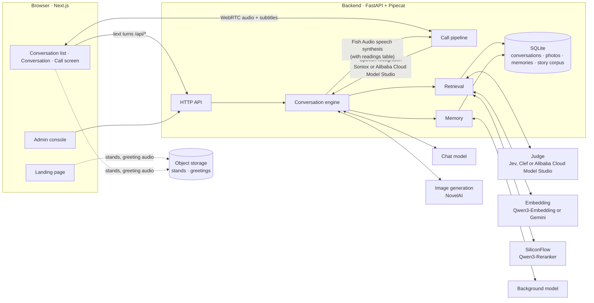

<div align="center">


**AI companions for real-time conversations with the idols of *THE iDOLM@STER SHINY COLORS***

Voice · Text · Story recall · Memory shared across characters

[简体中文](README.md) · **English** · [日本語](README.ja.md)

[](https://github.com/Sallyn0225/eidolon-sc/actions/workflows/ci.yml)
[](backend/pyproject.toml)
[](https://fastapi.tiangolo.com/)
[](https://github.com/pipecat-ai/pipecat)
[](frontend/package.json)
[](frontend/package.json)
[](docker-compose.yml)
[](LICENSE)

[Preview](#-preview) · [Features](#-features) · [Quick start](#-quick-start) · [Configuration guide](docs/configuration.en.md) · [Deployment](docs/deploy.md) · [Architecture decisions](docs/adr/)

</div>

---

Eidolon-SC lets you, as **a producer at 283 Production**, text or call the idols from the game. She answers in her own Japanese voice, with Chinese subtitles. She can recall the episodes she lived through in the game. She also remembers what you tell her, and word "gets around" among the idols.

All **28 idols** from the game's eight units, plus the office clerk Nanakusa Hazuki, are already set up and ready to talk. Once deployed publicly, anyone can sign in with Google or GitHub and use it.

> [!IMPORTANT]
> This is an unofficial fan project, not affiliated with Bandai Namco or the rights holders of *THE iDOLM@STER* series; the characters are played by AI. Story data is **not distributed with this repository**; you must prepare it yourself ([ADR-0003](docs/adr/0003-corpus-and-voices-stay-private.md)). Through their replies, the characters indirectly pass story content on to signed-in users; for this risk, see [ADR-0006](docs/adr/0006-open-to-the-public-with-oauth.md).

## 📸 Preview

<p align="center">
  
  <br>
  <sub>Calling Mano (櫻木真乃): you speak Chinese, she answers in her own Japanese voice, the subtitles keep in sync, and her stand changes expression with the emotion of each segment</sub>
</p>

<table>
  <tr>
    <td width="50%">
      <picture>
        <source media="(prefers-color-scheme: dark)" srcset="docs/images/app-dark.webp">
        
      </picture>
      <p align="center"><sub><b>Memory shared across characters</b>: you only told Hiori (灯織) about your cat, yet Kogane (恋鐘) says 「灯織から聞いたばい」 ("Hiori told me!")</sub></p>
    </td>
    <td width="50%">
      
      <p align="center"><sub><b>Outfits</b>: every card from the game is wearable, switchable between everyday clothes and stage costume</sub></p>
    </td>
  </tr>
  <tr>
    <td width="50%">
      
      <p align="center"><sub><b>Photos</b>: ask, and she takes one of herself in the moment</sub></p>
    </td>
    <td width="50%">
      
      <p align="center"><sub><b>Gifts</b>: draw every day, give her the ones she likes</sub></p>
    </td>
  </tr>
</table>

<table>
  <tr>
    <td width="33%"></td>
    <td width="33%"></td>
    <td width="33%"></td>
  </tr>
  <tr>
    <td align="center"><sub>Conversation list: sorted by most recent contact; search by Chinese name, kana, romaji or unit name</sub></td>
    <td align="center"><sub>Every Japanese line comes with a Chinese subtitle</sub></td>
    <td align="center"><sub>On a phone, the call screen fills the whole screen</sub></td>
  </tr>
</table>

<details>
<summary><b>Landing page</b>: a beam of white light splits into 29 image colors, one for each character</summary>

<br>


</details>

## ✨ Features

**Talk with her**

- 🎙️ **Real-time voice calls**: Full-duplex calls over WebRTC, in Chinese or Japanese. You can interrupt her at any time.
- 🇯🇵 **Japanese voice + Chinese subtitles**: She answers in Japanese, keeping her verbal tics, with a Chinese subtitle for every line ([ADR-0001](docs/adr/0001-japanese-replies-with-chinese-subtitles.md)). Proper names are pronounced from a readings table.
- 🎭 **A living stand**: During a call her Spine stand from the game breathes, blinks, moves her lips and changes expression with her emotion. When the game releases new cards, the weekly sync makes them wearable.
- 📷 **She sends photos**: Ask, and she takes one of herself in the moment and sends it. All-ages only ([configuration guide](docs/configuration.en.md#photos)).
- 💗 **Affinity and gifts**: What you say draws her closer or pushes her away; offend her too much and she hangs up, or ends the conversation. Draw gifts every day and give them to her; she responds. Daily tasks and achievements earn you extra draws.
- 💌 **She reaches out**: When you've been away a while, she says a few words first in your conversation; the closer you are, the sooner she does ([configuration guide](docs/configuration.en.md#reach-outs)).

**What she remembers**

- 📖 **Story recall**: Once the story corpus is imported, she recalls only the canon episodes **she appears in**.
- 🔄 **Kept in step with the game**: One command syncs the fan translations and the Japanese originals, so new cards and events can be recalled within a week. Songs and lives are in her world setting too.
- 🧠 **Memory shared across characters**: Tell Hiori something and Kogane will know too, and bring it up as "Hiori told me…" ([ADR-0002](docs/adr/0002-shared-memory-with-source-character.md)). You can see and delete everything she remembers.
- 🗂️ **Past conversations**: Start a new conversation any time; the old ones stay to read back, or to delete.
- 🪪 **Producer profile**: How she addresses you, your gender, time zone and birthday are all in settings; on your birthday she wishes you a happy one.
- 📊 **Stats**: See how many turns, call minutes and gifts you've shared with them, and export a share image.
- ⚡ **On-demand retrieval**: Each line is first checked for whether it needs a lookup, so small talk adds no latency.

**Deployment and operations**

- 👥 **Open to the public**: Sign in with Google or GitHub. Usage is limited per user and memories are isolated; users can delete all their data for good, and the database is backed up offsite, encrypted, every day.
- 📦 **Data packages**: Export conversations, photos, memories and producer profile as one zip, and carry on on another deployment. Affinity and gifts stay behind ([ADR-0025](docs/adr/0025-data-packages-leave-affinity-and-gifts-behind.md)).
- 🔑 **Bring your own keys**: Users can enter their own LLM, speech synthesis, speech recognition and image generation keys to use their own credits, and under some conditions not count toward their limits ([configuration guide](docs/configuration.en.md#bring-your-own-keys)). The keys stay in the browser ([ADR-0017](docs/adr/0017-own-api-keys-stay-in-the-browser.md)).
- 🛠️ **Admin console**: See usage, cost and live calls, change models and limits without a restart, ban users and post announcements. No one's conversations or memories are visible there.
- 🚦 **Service status**: Users can see from the conversation list whether each service is working.
- 🔌 **Swappable services**: Models can use OpenAI Chat Completions, Responses or Anthropic Messages. Speech recognition and embedding each offer two providers, the judge three; each service can go through a proxy on its own.
- 🚀 **One-command deployment**: A Docker Compose production config, with Caddy (automatic HTTPS) and coturn (TURN relay) built in. CI builds the images and publishes them to GHCR.

## 🚀 Quick start

You need Docker with Docker Compose, and a chat model that supports streaming and tool calling.

```sh
git clone https://github.com/Sallyn0225/eidolon-sc.git && cd eidolon-sc
cp .env.example .env    # fill in CHAT_LLM_BASE_URL, CHAT_LLM_API_KEY and CHAT_LLM_MODEL, then add the line EIDOLON_DEV_LOGIN=1
docker compose up --build
```

Open <http://localhost:3000> to see the landing page. Click 「登录」 (Sign in) at the top right, choose 「开发登录」 (Dev login) in the sign-in panel, and enter any name. After you agree to the privacy policy and terms of use and confirm you are 13 or older, you land on the conversation list. Pick an idol to start a conversation.

With only the chat model set, you can chat by text. Add other services' keys as you need them to turn on voice calls, story recall, memory and stands step by step:

| Feature | Required configuration |
|---|---|
| Text chat | `CHAT_LLM_*` |
| Voice calls | `FISH_AUDIO_API_KEY`, plus a speech recognition key: `SONIOX_API_KEY` (default) or Alibaba Cloud Model Studio's `DASHSCOPE_API_KEY` |
| Story corpus | An embedding key: `SILICONFLOW_API_KEY` (default) or `GEMINI_API_KEY` |
| Retrieval and memory | An embedding key, `SILICONFLOW_API_KEY` (reranking), plus a judge: `JEV_API_KEY` (default), or Cloudflare or Alibaba Cloud Model Studio credentials |
| Photos | A judge, plus an image generation key: `NOVELAI_API_KEY` |
| Stands and greetings | `EIDOLON_STAND_ASSETS_URL` and a bucket holding the assets |

How to configure each one and what it does is in the **[Configuration guide](docs/configuration.en.md)**. Every environment variable is documented in [`.env.example`](.env.example).

## 🧩 Architecture



- Typing and speaking go through **the same conversation engine** and are written into the same conversation record. A call just wraps speech recognition and speech synthesis around the engine.
- The chat model streams its output as `<ja>…</ja><zh>…</zh>` segments. Each Japanese segment goes to synthesis as soon as it arrives, without waiting for the whole reply.

## 📚 Documentation

| Document | Contents |
|---|---|
| [Configuration guide](docs/configuration.en.md) | Configuring models, characters, calls, stands, the story corpus, retrieval, memory, photos, sign-in, own keys, the proxy, service status and the admin console, and what each does |
| [Deployment guide](docs/deploy.md) (Chinese) | Deploying to a VPS: domain, firewall, OAuth, weekly story corpus sync, stand and greeting assets, upgrades, backup and restore, troubleshooting |
| [`.env.example`](.env.example) | Every environment variable, with descriptions |
| [Architecture decision records](docs/adr/) | Why it is designed this way: the Japanese voice, shared memory, opening to the public, own keys kept only in the browser and more |
| [`GLOSSARY.md`](GLOSSARY.md) | Domain glossary |
| [Community forks](docs/community-forks.md) (Chinese) | Gameplay others have built in their own forks, and how to list yours |
| [`DESIGN.md`](DESIGN.md) · [`PRODUCT.md`](PRODUCT.md) | Visual design system · Product positioning |

## 🌐 Deployment

The production config [`docker-compose.prod.yml`](docker-compose.prod.yml) has four services: caddy (HTTPS entry point), frontend, backend and coturn (TURN relay). CI publishes the frontend and backend images to GHCR:

```sh
docker compose -f docker-compose.prod.yml pull
docker compose -f docker-compose.prod.yml up -d
```

`deploy/db-backup.sh` backs the database up every day, encrypted, to a private bucket, and keeps the backups for 30 days by default. For the full steps, see the [deployment guide](docs/deploy.md) (Chinese).

## 💻 Development

**Backend** (Python 3.11+, `backend/`, using [uv](https://docs.astral.sh/uv/)):

```sh
cd backend
uv sync
uv run pytest && uv run pyright && uv run ruff check
uv run --env-file=../.env eidolon serve   # serves on :8000, reads ../characters/characters.toml
```

**Frontend** (Next.js 16 + [shadcn/ui](https://ui.shadcn.com/) + Tailwind CSS v4, `frontend/`):

```sh
cd frontend
npm install
npm run typecheck && npm test && sh scripts/check-discipline.sh
npm run build && BACKEND_URL=http://localhost:8000 npm run start   # serves on :3000, forwards /api/* to the backend
```

- **Interface**: A restrained LINE-like style, with her image color in the places that belong to her. The landing page is a visual world of its own, always dark ([ADR-0016](docs/adr/0016-landing-page-is-its-own-visual-world.md)). The visual design system is in [`DESIGN.md`](DESIGN.md); component conventions are in [`frontend/AGENTS.md`](frontend/AGENTS.md).
- **Stands**: To see stands, give the frontend the same `EIDOLON_STAND_ASSETS_URL` as in `.env`.
- **README screenshots**: With the frontend and backend both running, run `npm run readme-media` in `frontend/`. It recaptures the screenshots and animations in `docs/images/`.
- **CI**: For every PR and every push to main, GitHub Actions runs the checks above and shellcheck, then builds both images. Pushes to main and `v*` tags publish them to GHCR. Dependabot opens dependency updates every Monday.

## 📁 Project layout

```text
eidolon-sc/
├── backend/          # Python backend: FastAPI + Pipecat; conversation engine, calls, retrieval, memory, sync and the CLI (eidolon)
│   ├── src/eidolon/
│   ├── eval/         #   eval sets for reranking, the judge and memory (questions and labels only, no story text)
│   └── tests/
├── frontend/         # Next.js frontend: landing page, conversations, call screen, settings, admin console
├── characters/       # character config, character sheets, character facts, avatars, readings table, world setting
├── corpus/           # story data and the mirror cache (not committed)
├── deploy/           # Caddyfile, story corpus and stand sync scripts, database backup script
├── scripts/          # wizard for setting up the OAuth apps (setup-oauth.sh)
├── docs/             # configuration guide, deployment guide, architecture decision records, README images
├── docker-compose.yml          # local development
└── docker-compose.prod.yml     # production deployment
```

## 📄 License

The code in this project is released under the [GNU Affero General Public License v3.0](LICENSE) (AGPL-3.0), or (at your option) any later version. If you modify this project and provide it as a service to others over a network, you must make your modified source code available to those users.

The license covers only the code and documentation in the repository. The following are outside its scope:

- **Content from the game**: Story data, character voices and stand assets are not in the repository; when using them, follow the terms of their respective sources (ADR-0003). In the character sheets, character facts, avatars and README screenshots in the repository, the characters and settings belong to the game's rights holders.
- **Spine Runtimes**: [`frontend/public/vendor/spine-3.6/`](frontend/public/vendor/spine-3.6/README.md), used for the call-screen stand, is included unmodified and is under its own Spine Runtimes license ([ADR-0009](docs/adr/0009-spine-runtime-without-editor-license.md)). [`LICENSING.md`](LICENSING.md) grants an additional permission under section 7 of the AGPL that allows the two to be distributed combined.
- **Fonts and sound effects**: The landing page's font subsets are under the SIL Open Font License (see `frontend/src/app/(landing)/fonts/`). For the sources and licenses of the call sound effects, see [`CREDITS.md`](frontend/public/sounds/CREDITS.md).

## 🙏 Acknowledgements

- [LAPLACE Eidolon](https://laplace.live/eidolon): a real-time voice AI companion built for the VTuber Mingqian Nailü (明前奶绿); this project's architectural reference (none of its code is reused)
- [SCTranslationData](https://github.com/ShinyGroup/SCTranslationData): story text and Chinese translations
- [ShinyColorsDB](https://github.com/ShinyColorsDB): the mirror of the original scripts, and the stand assets
- [Pipecat](https://github.com/pipecat-ai/pipecat): real-time voice pipeline and WebRTC transport
- [Fish Audio](https://fish.audio/): speech synthesis
- [Soniox](https://soniox.com/), [Alibaba Cloud Model Studio](https://www.aliyun.com/product/bailian): speech recognition
- [SiliconFlow](https://siliconflow.cn/): Qwen3 Embedding and Reranker
- [Google Gemini API](https://ai.google.dev/): Gemini Embedding (an optional embedding service)
- [TypeSafe Jev](https://docs.typesafe.ai/), [OpenRouter](https://openrouter.ai/), [Cloudflare Workers AI](https://developers.cloudflare.com/workers-ai/), [Alibaba Cloud Model Studio](https://www.alibabacloud.com/help/en/model-studio/): the judge
- [Spine Runtimes](https://github.com/EsotericSoftware/spine-runtimes): playing the stands (spine-ts 3.6)
- [im@sparql](https://sparql.crssnky.xyz/imas/), Lantis, ふじわらはじめ, imas-db, wikiwiki: the idols, releases and lives in the world setting

<div align="center">

---

<sub>*THE iDOLM@STER SHINY COLORS* and its characters are ©Bandai Namco Entertainment Inc. This is an unofficial fan project, not affiliated with the rights holders; the characters are played by AI.</sub>

</div>
