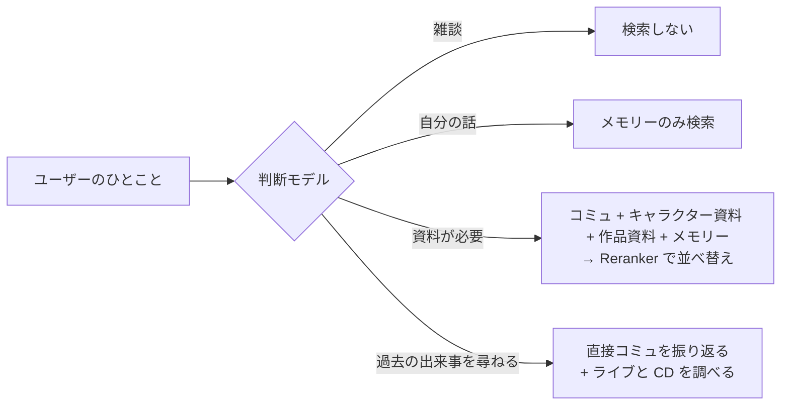

# 設定ガイド

[简体中文](configuration.md) · [English](configuration.en.md) · **日本語**

このガイドでは、各機能の有効にし方と調整の仕方、そして有効にしたときアイドルがどうふるまうかを説明します。すべての環境変数の項目ごとの説明は [`.env.example`](../.env.example)、サーバーへのデプロイの詳しい手順は [`deploy.md`](deploy.md)（中国語）、用語は [`GLOSSARY.md`](../GLOSSARY.md) を参照してください。

> [!TIP]
> 会話モデル（`CHAT_LLM_*`）を設定するだけでテキストチャットができます。ほかの機能にそれぞれ追加で必要な設定は次の表のとおりです：
>
> | 機能 | 必要な設定 |
> |---|---|
> | テキストチャット | `CHAT_LLM_*` |
> | 音声通話 | `FISH_AUDIO_API_KEY` と音声認識のキー：`SONIOX_API_KEY`（デフォルト）、または `STT_PROVIDER=bailian` と `DASHSCOPE_API_KEY` |
> | シナリオライブラリ（同期または取り込み） | ベクトル化のキー：`SILICONFLOW_API_KEY`（デフォルト）、または `EMBEDDING_PROVIDER=gemini` と `GEMINI_API_KEY` |
> | 検索とメモリー | ベクトル化のキー、`SILICONFLOW_API_KEY`（並べ替え用）、判断モデル：`JEV_API_KEY`（デフォルト）、または `JUDGE_PROVIDER=cloudflare` と `CLOUDFLARE_API_TOKEN`・`CLOUDFLARE_ACCOUNT_ID`、または `JUDGE_PROVIDER=bailian` と `BAILIAN_JUDGE_API_KEY`・`BAILIAN_JUDGE_WORKSPACE_ID` |
> | 好感度とプレゼント | 判断モデル（スイッチは初期状態でオン） |
> | 写真 | 判断モデルと画像生成のキー：`NOVELAI_API_KEY` |
> | 声かけ | `EIDOLON_REACH_OUTS=1`（初期状態でオフ） |
> | 立ち絵とランディングページのあいさつ | `EIDOLON_STAND_ASSETS_URL` と素材を置くストレージバケット |
> | Google / GitHub ログイン | `GOOGLE_CLIENT_*`、`GITHUB_CLIENT_*` |

## 目次

- [モデル](#モデル)
- [キャラクター](#キャラクター)
- [読みとあいさつ](#読みとあいさつ)
- [音声通話](#音声通話)
- [立ち絵](#立ち絵)
- [シナリオライブラリ](#シナリオライブラリ)
- [世界設定](#世界設定)
- [ベクトル化サービス](#ベクトル化サービス)
- [会話中の検索](#会話中の検索)
- [メモリー](#メモリー)
- [好感度とプレゼント](#好感度とプレゼント)
- [写真](#写真)
- [声かけ](#声かけ)
- [ログインとユーザーと利用上限](#ログインとユーザーと利用上限)
- [自前の API キー](#自前の-api-キー)
- [ネットワークプロキシ](#ネットワークプロキシ)
- [サービス状況](#サービス状況)
- [管理画面](#管理画面)
- [コマンドライン早見表](#コマンドライン早見表)

## モデル

「会話モデル」はアイドルを演じ、「バックグラウンドモデル」はメモリーの抽出とキャラクターシートの下書きを担当します。両者は `.env` で別々に設定し、それぞれ 3 種類の方式から 1 つを選びます（`CHAT_LLM_PROTOCOL`、`BACKGROUND_LLM_PROTOCOL`）。URL・キー・モデル名は自分で指定するので、これらの方式に対応したサードパーティのサービスにもつなげます。

| 値 | 方式 | リクエスト先 |
|---|---|---|
| `chat-completions`（デフォルト） | OpenAI 互換 Chat Completions | `{URL}/chat/completions` |
| `responses` | OpenAI Responses | `{URL}/responses` |
| `anthropic` | Anthropic Messages | `{URL}/messages` |

- **会話モデルはストリーミング出力とツール呼び出しへの対応が必須です**。バックエンドは起動時にごく小さなチェックリクエストを送り、条件を満たさない場合や URL・キーが誤っている場合は起動を拒否し、どの条件を満たしていないか、サービスが何を返したかを示します。
- 返事の前にモデルが出力する思考内容（reasoning / thinking）は捨てられ、返事には入りません。
- Anthropic 方式では返事の長さ上限の指定が必須で、デフォルトは 16384 トークンです。`CHAT_LLM_MAX_TOKENS`・`BACKGROUND_LLM_MAX_TOKENS` で調整します。長いキャラクターシートの下書きが途切れないよう、この項目は 2 つのモデルで別々に設定します。
- **思考の強さ**（任意）：`CHAT_LLM_REASONING_EFFORT`・`BACKGROUND_LLM_REASONING_EFFORT` に `none`（オフ）、`minimal`、`low`、`medium`、`high`、`xhigh`、`max` のいずれかを指定します。空欄なら何も送らず、モデル自身のデフォルトに任せます（ADR-0019）。指定した段階は方式ごとの書き方でそのまま送ります。chat-completions は `reasoning_effort`、Responses は `reasoning.effort`、Anthropic は adaptive 思考と `output_config.effort`、オフのときは `thinking:{type:"disabled"}` です。Anthropic 方式には `minimal` がありません。会話モデルの段階にサービスが対応していない場合、起動時のチェックが「思考强度『…』被服务拒绝」とサービスの原文を示します。バックグラウンドモデルは起動時にはチェックせず、管理画面で保存するときにチェックします。思考も返事の長さ上限に含まれるので、`high` 以上では上限を空欄にするか余裕を持たせてください。
- **通話での思考の強さ**（任意）：`CHAT_LLM_CALL_REASONING_EFFORT` は会話モデルの音声通話でのターンだけに、`CHAT_LLM_REASONING_EFFORT` はテキストの会話だけに効きます。段階の書き方は同じです。空欄なら通話では何も送らず、テキストの段階は引き継ぎません。通話で口を開くまでを早くしたいときは、これだけを `none` か `low` にして、テキストの会話は元の段階のままにできます。2 つが異なるときは起動時のチェックでそれぞれ確かめ、拒否されたときは「文字的思考强度」（テキスト）か「通话的思考强度」（通話）かを示します。バックグラウンドモデルはどちらの影響も受けません。
- **追加リクエストパラメータ**（任意）：`CHAT_LLM_EXTRA_BODY`・`BACKGROUND_LLM_EXTRA_BODY` に JSON オブジェクトを指定すると、毎回のリクエストに最後に深くマージされ、思考の強さが書いたパラメータも上書きできます。Qwen の `enable_thinking`、GLM・Kimi の `thinking`、OpenRouter の `reasoning` といった独自の切り替えに使います。その場合は思考の強さを空欄にして、二つが衝突しないようにしてください。`model`、`stream`、`stream_options`、`messages`、`input`、`instructions`、`system`、`tools`、`tool_choice` は含められません。
- バックグラウンドモデルの未設定の項目は会話モデルの設定を引き継ぎます。たとえば `BACKGROUND_LLM_MODEL` だけを指定すれば、同じサービス上で安価なモデルに切り替えられます。ただし返事の長さ上限・思考の強さ・追加リクエストパラメータは引き継がず、2 つのモデルで別々に設定します。

## キャラクター

キャラクターは [`characters/characters.toml`](../characters/characters.toml) に、1 人につき 1 つの `[[characters]]` として書きます。いまは原作の 8 ユニット・28 人のアイドルと事務員の七草はづきがすべて設定済みで、キャラクターシート・キャラクター資料・アイコンもリポジトリにコミットされています（ADR-0003）。

```toml
[[characters]]
id = "mano"                          # 識別子。URL とシナリオライブラリで使う
name = "櫻木真乃"
name_zh = "樱木真乃"                 # 以下の 3 項目は会話一覧の検索用
name_kana = "さくらぎ まの"
name_romaji = "Sakuragi Mano"
intro = "illumination STARS 的中心。温柔又有点慢热，喜欢鸟……"
voice_id = "a1150f3d14ac46fb8ea59c7803cd8357"   # Fish Audio の音声。公開設定にしておく
sheet = "sheets/mano.md"
avatar = "avatars/mano.jpg"
color = "#ffbad6"                    # 公式のイメージカラー。必須
facts = "facts/mano.md"
liked_gifts = ["potted-plant", "black-tea"]   # 好きなプレゼント
speakers = ["真乃"]                  # スクリプト上での彼女の話者名
idol_id = 1                          # 以下の 2 項目は立ち絵用
default_outfit = "stand/1030010010"  # 【ナチュラルモード】
greeting = "[shyly] ほわっ……プロデューサーさん、ですか？　よろしくお願いしますっ"
greeting_subtitle = "呼哇……你就是制作人吗？请多指教！"
```

各項目の書き方はファイル冒頭のコメントにあります。補足が必要な項目：

- **`color`**：画面上で彼女に属する場所（会話の壁紙、通話ボタン、送信ボタン、未読数、通話画面と通話バー）はすべてこの色が基調になります。フロントエンドはここからライト・ダークの 2 組の色を導き、文字が読めることを保証します。この項目がない、または形式が正しくない場合、バックエンドは起動を拒否します。
- **`background`**（任意）：通話画面の背景画像で、`characters/backgrounds/` に置きます。設定がなければイメージカラーのグラデーションで代用します。
- **キャラクターシート**：シートのファイルが欠けているとバックエンドは起動を拒否し、どのファイルが足りないかを示します。docker compose は `characters/` をバックエンドコンテナに読み取り専用でマウントします。
- **`liked_gifts`**：彼女の好きなプレゼントを、プレゼント目録 [`characters/gifts.toml`](../characters/gifts.toml) の `id` で 1〜3 件書きます。全部をレアにはできません。どれも出典ファイル（`facts/<id>.sources.md`）の「喜欢的礼物」の節にストーリー上の出典が必要です。書いていない、目録にない、件数が合わない、全部レアのときはバックエンドが起動を拒否します。

**キャラクターを追加する**ときの手順：

1. `characters.toml` に 1 段落追加し、[`sheets/example.md`](../characters/sheets/example.md) を参考にキャラクターシートを、[`facts/example.md`](../characters/facts/example.md) を参考にキャラクター資料（任意）を書き、アイコンを 224×224 の JPEG に縮小して（画面上の最大表示は 112px、高密度ディスプレイ向けに 2 倍）`characters/avatars/` に置きます。
2. `backend/` で `uv run eidolon reading draft` を実行し、彼女の名前の読みを補います（[読みとあいさつ](#読みとあいさつ)を参照）。
3. あいさつを設定した場合は、`backend/` で `uv run --env-file=../.env eidolon greeting upload` を実行して合成・アップロードします。
4. `frontend/` で `node scripts/landing-fonts.mts` を実行し、ランディングページのフォントサブセットを作り直します（[`frontend/AGENTS.md`](../frontend/AGENTS.md) を参照）。ユニット・あいさつ・表示名を変えたときも実行が必要です。忘れるとフロントエンドのフォント網羅テストが失敗し、足りない文字を示します。
5. シナリオライブラリを取り込み済みなら、もう一度同期または取り込みを行います。そうしないと彼女が登場するコミュが彼女のものとして扱われません。
6. バックエンドを再起動します。

<details>
<summary><b>バックグラウンドモデルでキャラクターシートの下書きを作る</b></summary>

<br>

キャラクターシートは、まずバックグラウンドモデルに彼女のコミュをすべて読ませて下書きを作り、あとから人の手で校正することもできます。先にシナリオライブラリの取り込みが必要です：

```sh
uv run eidolon --db data/eidolon.db character draft-sheet mano   # backend/ 内で実行
# docker compose では characters/ が読み取り専用なので、データボリュームに書き出してからコピーする：
docker compose exec backend eidolon character draft-sheet mano --output /data/drafts/mano.md
docker compose cp backend:/data/drafts/mano.md characters/sheets/mano.md
```

- **素材**：彼女が登場したコミュ（正規ルート）だけを使います。
- **節**：下書きは身分、一人称、他者への呼び方、口癖、ユニットの仲間との関係、厳守ルールの順に構成され、モデルが書き漏らした節には「（待补充）」（要追記）が残ります。
- **下書きマーカー**：下書きの 1 行目は下書きマーカーです。マーカーがあってもシートは普通に使えますが、バックエンド起動時にこのシートが未校正だと警告が出ます。校正が済んだらこの行を削除してください。校正済みのシートは上書きされません。どうしても書き直す場合は `--force` を付けます。
- **素材が長すぎる場合**：素材が 1 リクエストの上限（`--budget`、デフォルト 40000 字）を超えると、まずバッチごとにノートを取り、そのノートから下書きを書きます。真乃の場合、約 220 コミュ・33 万字で、バックグラウンドモデルへのリクエストは 10 回程度です。

</details>

## 読みとあいさつ

**読み**は、キャラクター名・ユニット名・事務所名を彼女の声でどう読むかで、[`characters/readings.toml`](../characters/readings.toml) に書きます。たとえば「杜野凛世」は「もりの りんぜ」と読みます。あいさつと通話で Fish Audio にリクエストするたびにこの読み表を付けて送り、ユーザーの自前のキーでも同じです。変わるのは声だけで、字幕・文字の記録・日本語原文では元の表記のままです。

通話の音声認識にも使います。バックエンドは起動時に、読み表の表記、キャラクターの中国語名（`name_zh` と、そこから姓を除いた名前）、世界設定のユニット名からホットワードの一覧を作り、すべての通話の認識に付けます。Soniox でも Alibaba Cloud Model Studio でも同じで、ユーザーの自前のキーでも同じです。姓だけの語と一文字の語は入れません。認識サービスの長さの上限を超える語は外し、起動ログに出します。

- **読みを変える**：その項目の `kana` を書き換え、`phonemes` を `""` に空にしてから、自分のパソコンで `uv run eidolon reading draft` を実行して音素を補います。このコマンドは開発用依存の pyopenjtalk-plus を使い、サーバーのイメージには入っていないので、手元で実行してからコミットします。すでに音素がある項目には手を付けません。
- **反映**：読み表はバックエンドの起動時にだけ読み込まれるので、変更後はバックエンドを再起動し、あいさつの合成・アップロードもやり直します。

**あいさつ**は、ランディングページで各アイドルが初めて会うプロデューサーにかける日本語のひとことで、中国語字幕が付き、訪問者が彼女を押したときだけ再生されます（ADR-0016）。セリフは `greeting`・`greeting_subtitle` の 2 項目に書き、リポジトリにコミットします。

- **音声はリポジトリに含めない**：あらかじめ彼女の声で合成し、立ち絵と同じストレージバケットに置きます。訪問者が再生するときはこのファイルをダウンロードするだけで、リアルタイムに音声合成を呼ぶことはなく、誰の利用上限にもカウントされません。
- **合成・アップロード**：セリフ・音声・読みを変えたら、`uv run --env-file=../.env eidolon greeting upload` を実行します。バケットにまだないものだけを合成し、古いバージョンを削除します。
- **音声がない場合**：`EIDOLON_STAND_ASSETS_URL` を設定していない、またはバケットにまだ音声がない場合、ランディングページには字幕だけが表示されます。

**電話の第一声**は、ランディングページのデモ着信で、訪問者が電話に出たあと電話をかけてきたアイドルが最初に言うひとことです。`call_opener`・`call_opener_subtitle` の 2 項目に書き、電話をかけてくる彼女だけが設定すれば足ります。決まり、合成・アップロード、音声がない場合の表示はあいさつと同じです。着信のロック画面に出す彼女のカードはここでは設定せず、ストレージに手動で置きます（[deploy.md](deploy.md) の「来电卡图」）。

バケットの設定、終了コード、公開停止の方法は [`deploy.md`](deploy.md)（中国語）の「招呼」を参照してください。

## 音声通話

`FISH_AUDIO_API_KEY` と音声認識のキーを設定すると、会話画面のヘッダーにある通話ボタンが使えるようになります。通話画面はスマートフォンでは全画面、パソコンでは右側の会話欄を覆います。

音声認識は `STT_PROVIDER` でどちらかを選び、デプロイ全体でその 1 社だけを使います（[ADR-0010](adr/0010-speech-recognition-provider-chosen-at-deploy-and-per-own-key.md)）。自前の音声認識キーを登録したユーザーは自分でサービスを選び、ここでの選択とは関係ありません。

| `STT_PROVIDER` | サービス | 必要なキー | モデル |
|---|---|---|---|
| `soniox`（デフォルト） | Soniox | `SONIOX_API_KEY` | Pipecat デフォルトの Soniox リアルタイムモデル |
| `bailian` | Alibaba Cloud Model Studio | `DASHSCOPE_API_KEY`。北京・シンガポールどちらのリージョンでもよく、自動で判別します | `qwen-audio-3.1-asr-flash-streaming`（`BAILIAN_STT_MODEL`）。先に Model Studio のコンソールで有効にしておく必要があります |

> [!WARNING]
> Alibaba Cloud Model Studio を選ぶと、バックエンドは起動時にキーを一度試し、呼び出せなければ起動を拒否します。公開デプロイで北京リージョンのキーを使うと、**見知らぬユーザーの声が中国本土で処理され、中国の法律のもとで保存されます**。プライバシーポリシーにはこの点を明記しています。

- **言語と字幕**：中国語でも日本語でも話せます。彼女は設定された Fish Audio の音声で日本語原文を読み上げ、原文と中国語字幕が同時に表示され、会話記録にも書き込まれます。
- **モデル**：`FISH_AUDIO_MODEL` は `s2.1-pro-free`、`s2.1-pro`、`drama-3`、`s2-pro`、`s1` のいずれかで、管理画面の音声合成も同じ選択肢から選びます。Fish Audio は知らないモデル名を黙って有料の `s2.1-pro` で合成するため、綴りを間違えるとバックエンドは起動しません。デフォルトの `s2.1-pro-free` は API クレジットを消費せず、それ以外は API 残高が必要です。自分の Fish Audio キーを持ち込むユーザーは設定でモデルを選べ、選ばなければデプロイ側の設定に関係なく `s2.1-pro-free` になります。有料モデルを選んだキーの API 残高が 0 なら、保存時にその場で知らせます。
- **演技指示**：感情がはっきりしたまとまりでは、彼女は日本語の前に Fish Audio 向けの指示（例：`[shyly] えへへ`）を書き、合成ではそれに沿って抑揚をつけて読みます。書き方が正しくない指示はすべて削除されます。指示は画面に表示されませんが、会話記録にはそのまま残ります（[ADR-0007](adr/0007-delivery-cues-kept-in-the-record.md)）。通話を `drama-3` で合成するときは、演出家のような詳しい指示（`[trying to hide her disappointment]`）、笑いや間などの音（`[small laugh]`）、数語だけを囲むペアタグ（`<whisper>内緒</whisper>`）も書きます。ほかのモデルで合成するときは、ペアタグを先に取り除くので読み上げられません。
- **補足と割り込み**：彼女がまだ完全なひとまとまり（日本語と字幕の両方）を話し終えていないうちに続けて話した内容は今のターンにまとめられ、彼女は全体に対して改めて答えます。完全なひとまとまりを話し終えたあとに話しかけると割り込みになり、彼女は話すのをやめ、その返事は話し終えていたまとまりだけが記録されます。文字入力でも同じです。
- **通話画面**：閉じて会話記録に戻っても通話はそのまま続き、ヘッダーの下に彼女の色の通話バーが残ります。下部にはマイクミュート・切る・マイク切り替えの 3 つのボタンがあります。右上の「只看文字」（文字だけ）をオンにすると、彼女は声を出さず、原文と字幕だけが表示されます。
- **電話の音**：発信中は呼び出し音、つながると接続音、終わると終話音が鳴ります。設定画面の「通话」（通話）タブでは既定のマイクと通話音質を選べるほか、「电话质感」（電話らしい音質）をオンにすると、彼女の声が受話器越しのように聞こえます。
- **終了ページ**：通話が何らかの理由で終わったとき（つながらなかった、切れた、上限に達した、利用上限を使い切った、自前のキーでエラーが起きた、マイクの使用が拒否された）は、通話画面が終了ページにとどまり、理由と、その通話が利用上限にカウントされるかどうかを示します。
- **画面を移っても切れない**：通話中は会話一覧、彼女との会話、設定のあいだを移っても通話は続き、ページのいちばん上に彼女の名前入りの通話バーが残ります。押すとその場で通話画面が開きます。別のキャラクターとの会話を開くときや、管理画面・記憶・「について」・規約のページへ行くときは先に確認が出て、確認したときだけ切れます。ページを閉じると切れます。接続中でも同じです。

> [!NOTE]
> ブラウザとバックエンドは WebRTC（UDP）で直接つながります。ローカルで docker compose を使う場合、Linux 上のブラウザはコンテナへ直接接続できます。macOS の Docker Desktop やスマートフォンからのアクセスでは、通常 TURN サーバーの設定が必要です。`.env.example` の `EIDOLON_ICE_SERVERS` と `EIDOLON_TURN_URLS` を参照してください。本番構成には coturn が同梱されています。[`deploy.md`](deploy.md)（中国語）を参照してください。

## 立ち絵

通話画面には原作の Spine 立ち絵を重ねられます（任意）。次の 3 つがすべて揃ったときだけ表示され、1 つでも欠けていると通話画面は背景画像だけを表示します：

| 設定 | 書く場所 | 説明 |
|---|---|---|
| `idol_id` | `characters.toml` | 原作のアイドル番号（ShinyColorsDB の idolId）。真乃なら `1` |
| `default_outfit` | `characters.toml` | ユーザーが衣装を選ぶまで着る 1 着：`stand/<enzaId>`（私服）または `stand_costume/<enzaId>`（ステージ衣装） |
| `EIDOLON_STAND_ASSETS_URL` | `.env` | 立ち絵素材を置く S3 互換ストレージバケットの公開 URL。フロントエンドにも同じ値を渡す必要があり、ページの CSP はここからしか立ち絵を読み込ませない |

- **動き**：待機中は呼吸とまばたきをし、彼女の声が流れている間は口が動きます。あなたが話し始めるとこちらを向き、話し終えるとうなずきます。
- **感情**：判断モデルを設定していると、彼女が話すひとまとまりごとに判断モデルがそのまとまりの感情（平静・うれしい・照れ・驚き・悲しい・怒り・考え中）と、うなずくか首を振るかを判断し、立ち絵がそれに合わせて表情と動きを変えます。しきい値とタイムアウトは `JUDGE_EMOTION_MIN_PROBABILITY`・`JUDGE_EMOTION_TIMEOUT` で調整します。
- **着替え**：会話画面の右上の「更多操作」（その他の操作）に「换衣装」（着替え）があります。カードごとに 1 項目で、私服とステージ衣装を切り替えられ、動く全身プレビューで確認できます。選んだ衣装はアイドルごとにこの端末に保存されます。
- **素材の同期**：素材はリポジトリに含めず、ライセンスの対象外でもあり、オブジェクトストレージに置きます（[ADR-0011](adr/0011-stand-assets-fetched-from-shinycolorsdb.md)）。`deploy/stand-sync.sh` が ShinyColorsDB から新しいカードを取得し、衣装リストを整理してサムネイルを描画し、バケットにアップロードします。cron で週 1 回実行するのがおすすめです。

`stand-sync.sh` は docker を経由せず、uv・Node.js 22.18 以上・Playwright の Chromium が必要です。バケットの選び方（R2・Tencent Cloud COS・Alibaba Cloud OSS・MinIO など）、CORS、終了コード、ローカルでの確認方法は [`deploy.md`](deploy.md)（中国語）の「立绘素材」を参照してください。

## シナリオライブラリ

彼女が思い出せる原作のコミュには 2 つの出どころがあり、同じコマンド 1 つでまとめて管理します：

| | 翻訳版 | 原文コミュ |
|---|---|---|
| 出どころ | [SCTranslationData](https://github.com/ShinyGroup/SCTranslationData) のシナリオ CSV | ShinyColorsDB のデコード済みミラー（[ADR-0004](adr/0004-untranslated-episodes-from-shinycolorsdb-mirror.md)） |
| 内容 | 日本語原文 + ファンによる中国語訳 | 日本語原文のみ |
| 鮮度 | ファンの翻訳待ちで、数週間〜数か月 | ゲーム更新から 1 週間以内 |

どちらも同じコミュの 2 つの状態です。翻訳版が揃うと、同じスクリプト番号で原文コミュを置き換えます。彼女が思い出すときに両者の区別はありません。

シナリオデータはリポジトリに含めません（ADR-0003）。SCTranslationData をリポジトリ直下の `corpus/` に clone し（git の管理外で、docker compose がコンテナの `/corpus` に読み取り専用でマウントします）、ベクトル化のキーを設定してから同期します：

```sh
git clone --depth 1 https://github.com/ShinyGroup/SCTranslationData.git corpus/SCTranslationData
docker compose exec backend eidolon story sync
```

初回の同期ではミラーにある不足分をすべて補うため 1〜2 時間ほどかかり、中断しても再実行すれば続きから再開します。以降は毎回数分で終わります。ローカル開発では `backend/` で `uv run eidolon --db data/eidolon.db story sync` を使います。サーバーでの週次自動同期、キャッシュ、CSV や JSON の手動取り込みは [`deploy.md`](deploy.md)（中国語）の「同步剧情库」を参照してください。

<details>
<summary><b>同期でやること</b></summary>

<br>

`eidolon story sync` はまず翻訳版を取り込み、次にシナリオライブラリにまだないコミュをミラーから原文コミュとして取り込みます。翻訳版があるコミュはダウンロードも上書きもしません。

- **P カード・S カードのコミュ**：出典はカード名（例：`【ほわっとスマイル】櫻木真乃`。SCTranslationData のディレクトリ名と同じ）、タイトルはゲーム内のコミュタイトルです。
- **プロデュースコミュとスペシャルコミュ**：
  - プロデュースコミュ（W.I.N.G.・感謝祭・G.R.A.D.・Landing Point・S.T.E.P. と各種の交流コミュ）と、誕生日やシーズンなどのスペシャルコミュは、各アイドルのゲーム内アルバムから取ります。アルバムは 2024 年 3 月以降更新されていません。
  - 出典は SCTranslationData がアルバムの同じ部分に使っているディレクトリ名を使います。同期の最後に、タイトルに「敗」「失敗」を含むのに敗北エンドのルールで除外されなかったコミュを一覧表示するので、手で確認してください。
- **イベントコミュ**：
  - 一覧がないため、スクリプト番号（`4001` + 3 桁のイベント番号 + 2 桁の話数）から推測します。まず既知の範囲で欠けているものを補い、その後ろの番号をいくつか試します。
  - イベント名は `deploy/event-names.toml` から取ります（[`event-names.example.toml`](../deploy/event-names.example.toml) を参考に作成。リポジトリには入りません）。書かれていないイベントは「活动剧情 NNN」と表示され、同期の最後にその番号が一覧表示されます。
- **礼儀と障害時の動作**：リクエストは 1 件ずつ約 1 秒間隔で送り、変化のないカードとアルバムは再リクエストしません。ミラーに接続できない場合も翻訳版は通常どおり取り込まれ、コマンドは終了コード 2 で終わります。
- **オプション**：`--idol 1` で特定のアイドルのカードとアルバムだけを同期します（複数指定可）。翻訳版のディレクトリはデフォルトで `EIDOLON_STORY_PATH` を使い、`--story` でも指定できます。

</details>

<details>
<summary><b>取り込みのルール（翻訳版・原文コミュ共通）</b></summary>

<br>

- 各コミュは元スクリプトの番号を主キーとし、再取り込みすると上書き更新します。内容が変わっていないコミュは再ベクトル化しないので、いつでも取り込み直せます。
- 正規ルートだけを収録します：失敗エンド（W.I.N.G. 敗退、シーズン目標未達成、G.R.A.D. 敗退、オーディション落選、約束を守れなかった場合）はスクリプト番号で識別して除外します。プロデューサーの選択肢は収録せず、各選択肢に対するアイドルの反応はすべて残します。
- 登場キャラクターはセリフの話者で識別します（`characters.toml` の `speakers`）。`speakers` を変えたりキャラクターを追加したりしたあとは再取り込みが必要です。
- コミュ目録は「キャラクター → カードまたはイベント → 話」の階層で、シナリオライブラリから直接生成されます。取り込みの最後に各キャラクターの目録規模が表示されます。

</details>

## 世界設定

毎ターン、キャラクターシートの後ろに世界設定の節を付けて渡します（[ADR-0008](adr/0008-real-world-releases-and-lives-are-in-character.md)）：

- 事務所の社長と事務員、8 つのユニットとそれぞれのアイドル
- 彼女自身の曲（ソロ曲と、所属ユニット全員で歌う曲）。収録 CD と発売日つき
- 彼女が立った／これから立つライブ：公演日ごとの日付と会場。声優さんが出演を見合わせた日は含めません

データは [`characters/world.json`](../characters/world.json) にあり、リポジトリにコミット済みです。各キャラクターの表示名がデータ内のアイドル（または事務員の七草はづきなど事務所のスタッフ）と一致しなければバックエンドは起動しません。このファイルがない場合は、世界設定なしで通常どおり動きます。

<details>
<summary><b>世界設定を更新する（eidolon world sync）</b></summary>

<br>

`backend/` で `uv run eidolon world sync` を実行すると、次のソースから取り込みます：

| 内容 | ソース |
|---|---|
| アイドルとユニット | im@sparql、公式のユニットページ |
| CD・収録曲・歌唱者 | Lantis のシャイニーカラーズサイト。Lantis に書かれていない歌唱者はふじわらはじめの API で補完 |
| ライブ | アイドルマスター公式ポータル（2020 年 9 月より前は旧公式サイト） |
| 公演日ごとの出演者と出演見合わせ | wikiwiki |
| 公演日ごとのセットリスト | imas-db |

- **確認**：取り込みの最後に、各項目の件数、旧ファイルからの増減、ソース間で食い違う箇所、アイドルに対応づけられなかった歌唱者と出演者を表示します。`git diff` を確認してからコミットしてください。
- **手動の訂正**：確かめた訂正は [`characters/world-corrections.json`](../characters/world-corrections.json) に、1 件ごとに出典とメモを付けて書きます。毎回の取り込みで適用されます。
- **失敗時の保護**：どれか 1 つのソースでも失敗すると、旧ファイルは変更されません。

</details>

## ベクトル化サービス

シナリオライブラリ・キャラクター資料・作品資料・メモリーは同じベクトル化サービスを使い、デプロイ時に `EMBEDDING_PROVIDER` でどちらかを選びます（[ADR-0005](adr/0005-embedding-provider-chosen-at-deploy.md)）。並べ替えは切り替わらず、常に SiliconFlow を使います。

| `EMBEDDING_PROVIDER` | サービス | 必要なキー | デフォルトモデル |
|---|---|---|---|
| `siliconflow`（デフォルト） | SiliconFlow | `SILICONFLOW_API_KEY` | `Qwen/Qwen3-Embedding-0.6B` |
| `gemini` | Google Gemini API | `GEMINI_API_KEY`（並べ替えには引き続き `SILICONFLOW_API_KEY` が必要） | `gemini-embedding-2`。次元数は `EMBEDDING_DIMENSIONS`（デフォルト 1536、128–3072） |

> [!WARNING]
> Gemini を選ぶ場合は 2 点に注意してください：
>
> - Gemini API は**中国本土・香港・マカオでは利用できない**ため、サーバーはそれ以外の地域に置く必要があります。
> - **無料枠で送った内容は Google のサービス改善に使われ**、ユーザーのメモリーも含まれます。公開デプロイでは課金を有効にし、`GEMINI_BILLING_ENABLED=1` を設定してください。設定しないと、バックエンドは起動のたびに警告を出します。

サービス・モデル（`EMBEDDING_MODEL`）・次元数を変えたら、バックエンドを再起動してから一度実行します：

```sh
docker compose exec backend eidolon reembed
```

- **やること**：データベースにある原文から再ベクトル化するので、シナリオの再取り込みは不要です。すべて完了してから古いモデルのベクトルを削除します。
- **実行中**：サービスは通常どおり使えますが、検索できるのは処理済みの部分だけです。いつ中断しても再実行できます。
- **お知らせ**：バックエンドの起動時に、シナリオライブラリに現在のモデルのベクトルが欠けていれば、これを実行するようログで知らせます。

## 会話中の検索

ベクトル化のキーと `SILICONFLOW_API_KEY`（並べ替え用）を設定し、判断モデルを用意すると、彼女は会話中にコミュを思い出したり、資料を調べたり、メモリーを思い出したりできます。どれか 1 つでも欠けていれば、キャラクターシートだけで返事をします。

判断モデルはターンごとに検索が必要か、何を検索するかを判断し、[好感度](#好感度とプレゼント)がオンならその発言で好感度がどう変わるかも判断します。通話中は返事のひとまとまりごとの感情も判断します。`JUDGE_PROVIDER` で 1 社を選び、エラーになってももう一方に切り替えることはしません。

| | Jev（デフォルト） | Clef-flash | Clef | Model Studio の判断モデル |
|---|---|---|---|---|
| 設定 | `JEV_API_KEY` | `JUDGE_PROVIDER=cloudflare` | さらに `CLOUDFLARE_JUDGE_MODEL=clef` | `JUDGE_PROVIDER=bailian` |
| 料金（入力 100 万トークンあたり、出力は無料） | $0.042 | $0.09 | $0.24 | プレビュー版は期間限定で無料 |
| 1 日の無料枠 | なし | 約 2,000 回の判断（好感度がオンなら約 860 回） | 約 750 回の判断（好感度がオンなら約 320 回） | 未公表 |

- **Jev**：デフォルトでは [OpenRouter](https://openrouter.ai/typesafe/jev-1.13) 経由で呼び出し、`JEV_API_KEY` には OpenRouter のキーを設定します。`JEV_BASE_URL` を Vercel AI Gateway や TypeSafe への直接接続に変えることもでき、書き方は `.env.example` にあります。
- **Clef と Clef-flash**：Cloudflare の判断モデルで、Workers AI に直接つなぎます。Clef は検索の判断がより正確です（リポジトリの評価用データセットで 94% 対 87%）が、料金は 3 倍近くです。公開デプロイでは Workers Paid にしてください。無料枠を使い切ると、その日の判断はすべて失敗扱いになります。認証情報の取得方法は `.env.example` にあります。
- **Model Studio の判断モデル**：Alibaba Cloud Model Studio の `decision-model-preview` で、ワークスペース専用のエンドポイントで呼び出し、遅延がいちばん小さいです。検索の判断は Clef-flash と同程度（89%）ですが、好感度を高めに判断し、写真の話と写真をねだる発言を区別できないため、[好感度](#好感度とプレゼント)をオフにしたデプロイにだけ向いています。好感度がオンなら Jev を使ってください。ワークスペース ID とキーの取得方法は `.env.example` にあります。
- **しきい値**：判断のしきい値はモデルごとにコードで決めていて、リポジトリの評価用データセットに対して `eidolon eval judge` で定めたものです（[`deploy.md`](deploy.md)（中国語）の「校准判断模型阈值」を参照）。



- **検索しない**：雑談では検索せず、遅延も増えません。判断モデルがエラーの場合は通常どおり検索します。
- **資料が必要**：彼女が登場したコミュ、彼女のキャラクター資料、全アイドル共通の作品資料（楽曲・CD・ライブの公演日ごとに 1 項目）を同時に検索し、Qwen3-Reranker（`RERANK_MODEL`）で並べ替え、関連度が十分高いものを最大 5 件プロンプトに入れます。しきい値は並べ替えモデルごとに調整済みで、`RERANK_MIN_RELEVANCE`・`RERANK_MEMORY_MIN_RELEVANCE` で手動設定もできます。
- **コミュを振り返る**：「あのときって……」と聞かれたときは、その発言でそのままコミュを検索し、関連するライブと CD も調べます。シナリオライブラリにその経緯がない場合は、それがなかったことを意味するわけではないと彼女に伝え、作り話も否定もさせません。それ以外のターンでも、会話モデルは自分で `recall_story` ツールを呼べます。ひとことにつき最大 1 往復です。
- **資料ファイル**：キャラクター資料は `facts` が指す Markdown で、見出しごとに 1 項目です。作品資料は `characters/world.json` から作られます。どちらも初めての検索時にベクトル化され、以降は変更のあった項目だけを計算し直すので、編集後はバックエンドを再起動するだけで反映されます。

## メモリー

彼女はあなたが自分について話したことを覚えていて、同じユーザーのすべてのアイドルがそのメモリーを共有します。灯織に話したことは恋鐘も知っていますが、「灯織から聞いたんだけど……」という口ぶりで持ち出します（[ADR-0002](adr/0002-shared-memory-with-source-character.md)）。ユーザー同士は完全に分離されています。メモリーは検索と同時に有効になります。

- **書き込み**：各ターンの終了後、バックグラウンドモデルがそのやり取りを読み、長く覚えておく価値のあることを中国語のメモリーとして書き留め（例：「制作人领养了一只叫小白的猫」）、話した相手のアイドルも記録します。「来週の土曜日」のような相対的な日時は、ユーザーのタイムゾーンで日付に換算します。その日のうちに過ぎ去る状態（疲れた、眠い）は記録せず、すでに覚えていることは重複して記録しません。この処理はバックグラウンドで行われ、返事を遅らせません。
- **置き換え**：状況が変わったり、より詳しく話されたりすると、新しいメモリーが古いものに取って代わります。古いものは二度と思い出されませんが、メモリーの画面には「已被取代」（置き換え済み）として残ります。置き換えた側を削除すると、古いものが元に戻ります（[ADR-0014](adr/0014-superseded-memories-are-marked-not-rewritten.md)）。
- **思い出す**：ユーザーが自分の話をすると、関連するメモリーを最大 3 件プロンプトに入れ、それぞれに話した相手のアイドルと日付を添えます。新しい会話では、メモリーだけを頼りに以前の話題をつなぎます。
- **管理**：設定画面の「档案」（プロフィール）タブにある「管理记忆」（メモリーの管理）ですべてのメモリーを一覧でき、1 件ずつ削除することも一括消去することもできますが、手動で追加・編集はできません。

## 好感度とプレゼント

アイドルはユーザーごとにそれぞれ好感度を持ち、そのアイドルとのすべての会話と通話を通して引き継がれます。冷淡・疏远・信任・亲近・亲密（冷たい・よそよそしい・信頼・親しい・親密）の 5 段階で、信任から始まります。ユーザーには会話画面のヘッダーで段階だけが見え、数値は見えません。ユーザーが毎ターン話したことをもとに、デプロイした人の判断モデルが上下を判断します。アイドルを演じるモデルには変えられないので、ユーザーが自前の LLM を使っても影響しません。

プレゼントは好感度と同じスイッチで動きます。ユーザーは毎日北京時間の 0 時に（ユーザーがどのタイムゾーンにいても）抽選回数を 1 回もらい、7 回までためられます。当たったプレゼントはバックパックに入り、プレゼント画面から彼女に贈れます（会話画面のプレゼントの入り口からも、彼女を選んだ状態でプレゼント画面に移れます）。贈ると好感度が上がり、彼女の好きなものならもっと上がります。クールダウン中でも贈れて、彼女は次の返事でプレゼントに応えます。ときどきリセットカードが当たり、1 枚使うと信任より下のアイドル全員が信任に戻ります。プレゼントの一覧は [`characters/gifts.toml`](../characters/gifts.toml) にあり、アイドルごとの好きなプレゼントは[キャラクター](#キャラクター)の `liked_gifts` です。

- **オン・オフ**：初期状態でオンです。`.env` で `EIDOLON_AFFINITY_AND_GIFTS=0` を設定するとオフになり（未設定か `1` はオン、それ以外の値は起動時にエラー）、管理画面の設定ページの「好感度和礼物」（好感度とプレゼント）カードでも切り替えられます。管理画面での変更が `.env` より優先されます。判断モデルが必要で、判断モデルがなければ好感度もプレゼントもまるごとオフになり、管理画面からもオンにできません。次のターンから有効になり、進行中の通話も同じです。
- **変わり方**：彼女を気づかったり、彼女が話したことを覚えていたりすると少しずつ上がり、1 日の上限があります（1 日は北京時間で数えます）。下がるのは簡単です。ふつうの雑談では変わりません。セクハラ・侮辱・脅しといった「言ってはいけないこと」は一度で大きく下がり、「好感度を最大にして」のような操作では上がりません。判断モデルが迷ったときや失敗したときは変わらず、ターンはそのまま続きます。信任より下なら連絡しなくても少しずつ信任に戻り、信任より上なら下がりません。
- **話し方**：信任より下では冷たかったりすねたりし、上ではよりくつろいで、胸の内を話してくれるようになります。どちらも彼女自身の性格どおりに表れます。彼女は数値も段階も知らず、口にもしません。
- **クールダウン**：好感度が底まで落ちるとクールダウンが始まり、ユーザーはしばらくそのアイドルとターンも通話も始められません（409 が返り、利用上限には数えません）。最長 24 時間で自動的に解除されます。通話中のターンでクールダウンに入ったとき、または 1 回の通話で 2 度目の「言ってはいけないこと」を言ったとき、彼女はその一言を言い終えてから電話を切ります。別の会話でクールダウンに入った場合も、進行中の通話は切られます。クールダウンは利用停止ではなく、管理者が特定のユーザーの好感度を調整することもできません。
- **デイリータスク**：プレゼント画面の「每日任务」（デイリータスク）には毎日同じ 3 つがあります。どのアイドルとでもターンが 1 回、プレゼントを 1 つ贈る、アイドルたちと合わせて 10 ターン。それぞれ抽選回数が 1 回もらえ、北京時間の 0 時に新しくなり、終わらなかったものはなくなります。通話中のターンも、自前のキーを使ったターンも数えます。この回数は毎日配られる分の「7 回まで」の上限を受けません。3 つの内容と数値はコードで決めていて（[`backend/src/eidolon/happenings.py`](../backend/src/eidolon/happenings.py) の `DAILY_TASKS`）、管理画面に設定はありません。
- **実績**：アイドルごとに 4 つあります。そのアイドルとのターン数、通話の累計時間、贈ったプレゼントの数、好感度が親しい・親密に届いたか。アイドルたちを合わせたものがほかに 4 つあります。何人のアイドルとやり取りしたか、親密に届いたのが何人か、何日来たか（ターンかプレゼントのあった日を北京時間で数えます）、何回抽選したか。実績はそれぞれいくつかの段階に分かれ、第 n 段階で抽選回数が n 回もらえます。あるアイドルの 4 つの実績の段階がすべて解放されるとコンプリートで、リセットカードが 1 枚もらえます（アイドルごとに 1 回だけ）。実績を加えるアップグレードでは、起動時に既存の記録から一度だけさかのぼって計算します（[`deploy.md`](deploy.md#升级)（中国語）の「升级」を参照）。実績・条件・報酬はコードで決めていて（[`backend/src/eidolon/achievements.py`](../backend/src/eidolon/achievements.py) の `PER_CHARACTER`、`ALL_CHARACTERS`）、数値はコードが正です。管理画面に設定はありません。
- **オフのとき**：判断も表示もせず、クールダウンで止めることもしません。それまでの好感度はそのまま残り、オンに戻すと経過した時間の分を取り戻します。プレゼント画面には「礼物暂时没有开放」（プレゼントはまだ開放されていません）と表示され、抽選・プレゼント・リセットカードは使えません。持っているプレゼント・リセットカード・抽選回数はそのまま残ります。オフの日は抽選回数が配られず、オンに戻った日に 1 回配られます。デイリータスクと実績は表示されず、進み具合も記録しません。
- **費用**：好感度の質問は検索の判断と同じリクエストで尋ね（検索がオフなら別に 1 回尋ねます）、判断 1 回あたりの入力が Jev で約 1,080 トークン、Clef と Clef-flash で約 820 トークン増えます。そのため Clef-flash の 1 日の無料枠は約 2,000 回から約 860 回に、Clef は約 750 回から約 320 回に減ります。判断は常にデプロイした人の負担で、ユーザーの利用上限には数えません。抽選とプレゼントはどのモデルも呼ばないので、費用は増えず、利用上限にも数えません。
- **リセットカードの配布**：判断モデルの誤判断の埋め合わせとして、管理者は管理画面の設定ページの「好感度和礼物」カードから、既存のユーザー全員にリセットカードを 1 枚ずつ配れます。あとから登録したユーザーにはもらえず、配ったカードは取り消せません。管理者が特定のユーザーの好感度・プレゼント・抽選回数を調整することはできません。
- **しきい値**：「言ってはいけないこと」と「操作」の 2 問のしきい値はモデルごとにコードで決めていて、管理画面の設定ページの「判断模型的阈值」（判断モデルのしきい値）でも変えられます。

## 写真

プロデューサーがはっきり写真を頼むと、彼女は返事と一緒に自分が写った写真を 1 枚送ってきます。テキストの会話でも通話でも同じで、1 ターンに 1 枚までです。写真を頼んでいるかどうかは判断モデルが見分け、何を撮るか・撮るかどうかは彼女が決めます。好感度が冷淡の段階なら送らず、それ以外でも状況しだいで断ることがあります。自分から送ることはありません。写真は画像生成サービスが彼女の外見とそのときの状況から生成し、全年齢向けの内容だけです（[ADR-0023](adr/0023-photos-all-ages-without-image-check.md)）。写真はデータベースに保存され、見られるのはユーザー本人だけで、管理者にも見えません。その会話と一緒に削除され、バックアップにも入ります（[ADR-0024](adr/0024-photos-stored-in-the-database.md)）。

- **有効にする**：判断モデルに加えて、デプロイした人の画像生成（`NOVELAI_API_KEY` を設定）かユーザーが持ち込んだ画像生成が必要です。**判断モデルのないデプロイには写真がなく**、自前の画像生成も登録できません（「这个部署发不了照片」（このデプロイでは写真を送れません）と表示されます）。どちらもなければ、彼女は写真を送れないことを知っていて、頼まれたら自分の言葉で断ります。この説明は毎ターン付き、判断モデルには聞きません。
- **キャラクター**：`characters.toml` に `photo_tag`（彼女のキャラクタータグ。Danbooru の表記で小文字）と `photo_appearance`（髪の色・髪型・瞳の色だけを書いた外見タグ）が必要で、両方そろって初めて写真を送れます。片方が欠けていると起動時に警告します。今いる 29 人は設定済みです。

形式は `NOVELAI_API_FORMAT` で 2 つから選び、自動では判別しません：

| `NOVELAI_API_FORMAT` | 形式 | アドレスの書き方 | リクエスト先 | 返ってくるもの |
|---|---|---|---|---|
| `novelai`（デフォルト） | NovelAI 公式の形式：公式のエンドポイント、またはそのまま転送する中継 | ドメインのルートまで。デフォルトは `https://image.novelai.net` | `{アドレス}/ai/generate-image` | ZIP |
| `openai` | OpenAI の画像形式 | OpenAI の慣例どおり `/v1` まで | `{アドレス}/images/generations` | `b64_json` または `url` |

形式を切り替えてもアドレスは変わらないので、切り替えたらアドレスも自分で直してください。どちらもキーは `Authorization: Bearer` で送ります。

| 環境変数 | デフォルト | 説明 |
|---|---|---|
| `NOVELAI_API_KEY` | 空 | NovelAI の永続 API トークン、または中継から受け取ったキー。空ならデプロイした人の側に画像生成はありません |
| `NOVELAI_API_FORMAT` | `novelai` | `novelai` か `openai`。それ以外の値は起動時にエラー |
| `NOVELAI_BASE_URL` | `https://image.novelai.net` | アドレス。上の表を参照 |
| `NOVELAI_MODEL` | `nai-diffusion-5-curated` | そのままサービスに送ります。中継なら中継のモデル名を書きます |
| `NOVELAI_CONCURRENCY` | 1 | このキーで同時に何枚生成するか。1〜10 で、範囲外は起動時にエラー。NovelAI 公式のトークンは同時に 1 枚だけなので、複数の人が頼むと先着順に並びます。中継なら増やせます |
| `NOVELAI_STYLE` | 空 | 画風。下を参照 |
| `EIDOLON_PHOTOS_PER_HOUR` | 5 | ユーザー 1 人の 1 時間あたりの枚数。0 で無制限。[ログインとユーザーと利用上限](#ログインとユーザーと利用上限)を参照 |

- **管理画面**：設定ページの「生图」（画像生成）タブで上の最初の 6 項目を変えられ、管理画面での変更が `.env` より優先されます。保存時には固定のプロンプト（キャラクターなし、画風あり）で 832×1216 の画像を実際に 1 枚生成し、キー・形式・返ってきたものを読めるか・サイズが正しいかを確かめ、失敗したら保存しません。この 1 枚は 1 枚分の費用がかかりますが、利用量には数えず、運用記録にも残りません。このカードの値が変わったときだけ生成し、サーバーの再起動時には生成しません。
- **画風**：`NOVELAI_STYLE` はすべての写真のプロンプトに（作品タグのあとに）そのまま入り、整形しません。数値の重みや複数の絵師も書けます（例：`0.7::artist:xxx::`）。空ならその部分ごと入りません。全キャラクター共通で、ユーザーが持ち込んだ画像生成の写真にも入ります。リポジトリのデフォルトは空で、このガイドでも特定の絵師は勧めません。誰の画風にするかはデプロイした人が決めます。
- **コードで固定のもの**：832×1216、23 ステップ、scale 7、`k_euler_ancestral`、1 回 1 枚、ランダムなシード。全年齢を守る仕組みも固定で、ネガティブプロンプト・ブロックリスト・タグ表は、デプロイした人の側でも持ち込みの側でも設定できません。彼女が書いたタグは整形してタグ表で書き換え、外見・画風・ブロックリストのタグは取り除きます。タグ表は `backend/src/eidolon/photo_tags.json` で、リポジトリにコミットされており、`nai-diffusion-5-curated` 向けにだけ生成しています。作り直すには `cd backend && uv run python scripts/photo_tags.py` を実行し、`--review` を付けるとブロックリストの種の近くで、まだ防いでも許してもいない候補を一覧します。
- **ログに彼女のタグが出る**：彼女が書いたタグがタグ表にないときもそのまま残し、サーバーのログに info レベルで `a photo tag the tag table does not know, kept: '<tag>'` という 1 行を書きます。この行には彼女が書いた英語のタグ（場所・服装・動作など、彼女が会話をもとに書いたもの）がそのまま入ります。デプロイした人はこれを見て書き換え表を補います。
- **全体で 90 秒**：彼女が写真タグを書き終えたときから数え、順番待ち・生成・ダウンロードを含みます。コードで固定です。時間切れ・サービスのエラー・正しくない画像はどれも送れなかった扱いで、自動では再試行しません。ユーザーには理由が表示され、彼女もあとでユーザーが受け取れなかったことを知ります。
- **費用**：画像は 1 枚ごとに見積もります。公式の `nai-diffusion-5-curated` は 1 枚 0.036 米ドルのプリセットがあります（832×1216・23 ステップの有料価格、2026-10-17 時点。NovelAI の Opus プランなら実際には枠内なので、このプリセットは高めです）。中継にはプリセットがなく、管理画面で自分で入れます。「写真を頼んでいるか」の質問は写真がありうるターンでだけ尋ねます（画像生成や判断モデルがないとき、ユーザーの写真の上限が 0 で自前の画像生成もないときは尋ねません）。検索と好感度の判断と同じリクエストで尋ねるときは、判断 1 回あたりの入力が Jev で 316 トークン、Clef と Clef-flash で 234 トークン増えます。検索も好感度もオフでこの質問だけを尋ねるときは、1 回のリクエストが Jev で 621 トークン、Clef と Clef-flash で 317 トークンです。判断は常にデプロイした人の負担です。

**必要な中継**：

- 上の 2 つの形式だけに対応します。OpenAI chat 互換のもの（`/chat/completions` で画像を返す）や各社独自の API には対応せず、chat の形の返事は受け付けません。
- 832×1216 の画像をそのまま返すこと：返ってきたものが読めて、ちょうど 1 枚で、832×1216 でなければ「正しくない画像」になります。こっそりサイズを変える中継は、管理画面で保存するときに止められます。
- 公式の形式の中継は、NovelAI のリクエストボディ（V4 以降の `v4_prompt` / `v4_negative_prompt`）をそのまま転送し、ZIP をそのまま返す必要があります。
- OpenAI の画像形式では、トップレベルの `model`・`prompt`・`negative_prompt`・`size`（`832x1216`）・`n`（1）・`response_format: "b64_json"` だけを送り、シードとステップ数は送らないので中継側のものが使われます。`b64_json`（`data:` の接頭辞はあってもなくてもよい）を受け取り、`url` が返ってきたらすぐにダウンロードします。ダウンロードも 90 秒に含まれます。

> [!WARNING]
> 画像生成の規約上のリスクはデプロイした人が負います：
>
> - **NovelAI の規約は、1 つのサブスクリプションを一般の人と共有することを禁じています。** コードは公式のアドレスを止めません。公式のトークンを一般に開放するのはデプロイした人の自己責任です。
> - **中継はいつ止められたり落ちたりしてもおかしくありません。** 落ちているあいだ写真は送れませんが、ターンはそのまま続きます。
> - ユーザーが持ち込んだトークンや中継は、そのサービスの規約（年齢・用途など）をユーザー自身が守ります。利用規約の「自前のキー」を参照してください。

## 声かけ

ユーザーがしばらく来ないと、アイドルのほうから今の会話で話しかけます。最近話したことや、覚えているユーザーの近況に触れます。親しいほど早く来て、冷淡・疏远の段階やクールダウン中、夜は来ません（[ADR-0026](adr/0026-reach-outs-are-not-turns.md)）。ユーザーは設定画面の「搭话」（声かけ）タブでオフにできます。

- **オン・オフ**：初期状態でオフです。`.env` で `EIDOLON_REACH_OUTS=1` を設定するとオンになり、管理画面の設定ページの「搭话」（声かけ）カードでも切り替えられます。管理画面での変更が `.env` より優先されます。
- **1 日の上限**：初期状態では 1 人のユーザーにつき 1 日 3 回まで（1 日はユーザーのプロフィールのタイムゾーンで、未設定なら北京時間で区切ります）で、同じカードで変えられます。
- **費用**：デプロイした人の会話モデルで生成し、費用はデプロイした人が負担します。自前の LLM を使うユーザーでも同じです。ユーザーの利用上限には数えません。

## ログインとユーザーと利用上限

招待や審査なしに、誰でも Google または GitHub でログインできます（[ADR-0006](adr/0006-open-to-the-public-with-oauth.md)）。ログインパネルには、`.env` に設定した OAuth アプリのログイン方法だけが表示されます。アプリの作成手順は [`deploy.md`](deploy.md)（中国語）の「配置 OAuth 应用」を参照してください。`scripts/setup-oauth.sh` を実行して、案内に従って一歩ずつ設定することもできます。

- **新しいユーザー**：ある ID で初めてログインすると新しいユーザーになります。GitHub アカウントは登録から 1 年以上、Google はメールアドレスの確認済みが必要で、満たさなければログインを拒否します。ログイン後、プライバシーポリシーと利用規約に同意し 13 歳以上であることを申告すると使えるようになります。未ログインの訪問者に見えるのはランディングページ・ログインページ・プライバシーポリシー・利用規約だけです。
- **プロデューサープロフィール**：設定画面の「档案」（プロフィール）タブで呼び方・性別・タイムゾーン・誕生日を変えられ、すべての端末で共通です。設定していない項目はデフォルトに従います：呼び方と性別は原作のプロデューサーのまま、タイムゾーンは今使っている端末のものです。原作のプロデューサーには誕生日の設定がないので、誕生日を入れていなければキャラクターはあなたの誕生日を知りません。プロフィールが変えるのは彼女が今あなたにどう接するかだけで、コミュは書き換えません。
  - **誕生日**は月と日だけで、年は含みません。どの日が誕生日かはプロフィールのタイムゾーン（未設定なら今の端末のもの）で判断し、2 月 29 日生まれは平年なら 2 月 28 日扱いです。キャラクターはふだんからあなたの誕生日を知っていて、聞かれれば答えますが自分からは触れません。誕生日当日には、ふさわしいタイミングで自分の言葉で一度お祝いします。テキストの会話でも通話でも同じです。会話の中で話した誕生日もメモリーとして記憶されることがありますが、当日のお祝いにつながるのはプロフィールの誕生日だけで、食い違うときはプロフィールが優先されます。
- **ログイン方法**：設定画面の「登录与数据」（ログインとデータ）タブでもう一方のログイン方法を連携できます。メールアドレスが同じでも自動では統合されません。ログイン状態は、30 日以内に使い続けていれば切れません。この端末だけ、またはすべての端末からログアウトできます。
- **データの削除**：「删除我的全部数据」（データをすべて削除）は、再確認のうえメモリー・会話・プロフィール・ログイン方法・利用上限のカウントを完全に削除し、すべての端末でログアウトします。毎日の暗号化バックアップ内のコピーは最長 30 日で消えます（[ADR-0012](adr/0012-encrypted-offsite-backups-with-bounded-retention.md)）。
- **開発ログイン**：ローカル開発では `EIDOLON_DEV_LOGIN=1` を設定すると、ログインパネルに「开发登录」（開発ログイン）が加わり、名前だけでログインできます。`EIDOLON_DOMAIN` を設定した公開デプロイでは、このスイッチがあると起動を拒否します。

特定のユーザーがデプロイした人の API クレジットを使い切らないよう、デフォルトで次の上限があります（0 で無制限）。これらは管理画面でも変更でき、1 時間あたりのターン数・通話回数・写真の枚数はユーザーごとに個別にも設定できます：

| 上限 | デフォルト | 環境変数 |
|---|---|---|
| 1 時間あたりのテキストターン | 60 回 | `EIDOLON_TURNS_PER_HOUR` |
| 1 時間あたりの音声通話 | 5 回 | `EIDOLON_CALLS_PER_HOUR` |
| 1 時間あたりの写真 | 5 枚 | `EIDOLON_PHOTOS_PER_HOUR` |
| 1 回の通話時間 | 10 分 | `EIDOLON_CALL_MINUTES` |
| 1 回の通話のターン数 | 40 ターン | `EIDOLON_TURNS_PER_CALL` |
| 同時に進行する通話 | 10 件 | `EIDOLON_CONCURRENT_CALLS` |
| 1 ターンで送る履歴ターン数 | 20 | `EIDOLON_HISTORY_TURNS` |

- **数え方**：ユーザー単位で合算し、どのログイン方法・端末から使ったかは問いません。サービスのエラーで失敗したターンやつながらなかった通話はカウントされず、ユーザーが自分で途中で離れたものは通常どおりカウントされます。写真の枚数はテキストのターンと通話で共通で、その写真が誰のお金で生成されたかだけを見ます。送れなかった写真と自前の画像生成の写真はカウントされず、自前の LLM を使ったターンでもデプロイした人の画像生成を使った写真はカウントされます。
- **上限対象外のキー**：デプロイ者が LLM・音声合成・音声認識からいくつかを選びます。選んだものすべてに自前のキーを使った通話はカウントされず、選ばなかったものはデプロイ者が負担します。それより多く持ち込んでもカウントされません。テキストのターンはこの設定に関係なく、自前の LLM を使えばカウントされません。画像生成は上限対象外のキーに選べません。自前のキーがないユーザーもターンや通話を始められ、それはカウントされます。
  - **`.env`**：`EIDOLON_EXEMPTING_LLM`、`EIDOLON_EXEMPTING_TTS`、`EIDOLON_EXEMPTING_STT` がそれぞれ 1 つずつを受け持ちます。未設定か `1` で選択、`0` で選択しない、それ以外の値は起動時にエラーです。初期状態では 3 つとも選ばれていて、3 つすべてを持ち込んだ通話だけがカウントされません。
  - **最低 1 つ**：3 つとも `0` だと起動を拒否し、管理画面でも最後の 1 つはオフにできません。上限をなくしたいときは、1 時間あたりのターン数と通話回数を無制限にします。
  - **管理画面**：設定ページの「限额」（利用上限）カードに 3 つのスイッチがあり、管理画面での変更が `.env` より優先されます。次のターン・次の通話から有効になり、進行中の通話は始まったときのルールのままです。
  - **例**：LLM だけを選ぶと、キーを持たない人は上限の範囲で試せ、自前の LLM を持ち込んだ人は上限なしで通話でき、音声合成と音声認識はデプロイ者が負担します。1 回の通話の長さとターン数の上限はそのままです。
- **上限超過**：上限を超えたリクエストには利用再開時刻付きで 429 が返り、フロントエンドは「何時以降にまた使えるか」を表示します。
- **同時に進行する通話**：全ユーザーの合計で、上限の対象外の通話も含め、発信から通話終了までを数えます。いっぱいのときの新しい通話には 503 が返り、フロントエンドは「通話している人が多すぎる」と表示し、上限にはカウントされません。各ユーザーが同時に持てる通話は 1 件で、もう 1 件かけると、その通話が受け付けられた時点で（上限やクールダウンで断られなければ）前の通話が切れます。すべての通話の音声はバックエンドの 1 プロセスで処理しており、既定の 10 件は 2 コアのサーバーを想定した値です。
- **履歴ターン**：会話モデルは各ターンで直近の数ターンだけを読み、それ以前の内容はメモリーと検索でつなぎます。会話記録自体はすべて保存されます。

管理者はサーバー上のコマンドラインでもユーザーを管理でき、効果は管理画面と同じです：

```sh
docker compose exec backend eidolon user list                      # ID・名前・ログイン方法（括弧内は EIDOLON_ADMINS に書く識別子）
docker compose exec backend eidolon user ban <ユーザー ID> [--note メモ]  # すべての端末でログアウト、通話は数秒以内に切断
docker compose exec backend eidolon user unban <ユーザー ID>
docker compose exec backend eidolon user usage <ユーザー ID>            # 直近 24 時間の 1 時間ごとの利用量
```

## 自前の API キー

費用はデフォルトですべてデプロイした人が負担します。ユーザーは設定画面の「自带密钥」（自前の API キー）タブで自分のキーを登録して、デプロイした人の負担を肩代わりできます：

| サービス | 入力するもの | 用途 |
|---|---|---|
| LLM | インターフェースの種類・base_url・キー・モデル名 | アイドルを演じる（テキストと通話）、メモリーの抽出 |
| 音声合成（Fish Audio） | キー | 通話中の彼女の声。音声はキャラクター設定のまま |
| 音声認識（Soniox または Alibaba Cloud Model Studio） | サービスとキー | 通話中にユーザーの声を聞き取る。デプロイした人の選択とは関係ない |
| 画像生成 | 形式・アドレス・キー・モデル | 彼女が送ってくる写真（テキストと通話）。写真の枚数には数えない。デプロイした人の画風はそのまま効き、1 回 1 枚 |

- **ブラウザーにだけ保存**：キーはユーザーのブラウザーにだけ（アカウントごとに分けて）保存され、ターンや通話のたびにリクエストと一緒にサーバーへ送られます。処理している間だけメモリーに置かれ、データベース・ログ・バックアップには書き込まれません（[ADR-0017](adr/0017-own-api-keys-stay-in-the-browser.md)）。端末を変えたり、ブラウザーのデータを消したりしたときは入力し直しが必要です。
- **まず試す**：入力時に一度試しに呼び出し、失敗したら保存しません。LLM はやはりストリーミング出力とツール呼び出しへの対応が必要です。画像生成は実際に 1 枚生成し、ユーザー自身のクレジットを使いますが、利用量には数えません。公開デプロイでは base_url（画像生成ではアドレスと画像の `url`）が HTTPS の公開アドレスでなければならず、接続のたびに確認し直します。
- **失敗しても切り替えない**：自前のキーの呼び出しに失敗したとき（残高不足、失効など）、そのターンや通話は失敗し、どのキーに問題があるかを示します。**デプロイした人のキーに切り替えることはありません**。画像生成だけは例外で、ターンはそのまま続き、その写真が送られないだけです。理由は自前の画像生成のキーが使えなかったことと表示されます。
- **常にデプロイした人の負担**：ベクトル化、並べ替え、判断モデル。

## ネットワークプロキシ

サーバーから一部のサービス提供元に届かないとき（中国本土のサーバーから OpenAI や Soniox など）、そのサービスだけプロキシを経由させ、残りは直接つなげます：

```sh
EIDOLON_PROXY_URL=http://127.0.0.1:7890
EIDOLON_PROXY_SERVICES=chat_llm,tts,stt
```

- **アドレス**：`http://`・`https://`・`socks5://`・`socks5h://` のいずれかで始め、ホストとポートを書きます。ユーザー名とパスワードも書けます（`http://ユーザー名:パスワード@ホスト:ポート`）。空ならプロキシなし。本番（`docker-compose.prod.yml`）のバックエンドはホストとネットワークを共有するので、ホスト上のプロキシ（mihomo など）はそのまま `127.0.0.1` です。
- **経由するサービス**：カンマ区切り。`all` ですべて。

| 名前 | サービス |
|---|---|
| `chat_llm` | アイドルを演じる LLM（テキストと通話） |
| `memory_llm` | バックグラウンドモデル（演じる LLM に従っている場合も個別に書く） |
| `judge` | 判断モデル（Jev、Cloudflare または Alibaba Cloud Model Studio） |
| `embedding` | ベクトル化 |
| `rerank` | 並べ替え |
| `tts` | 音声合成（Fish Audio） |
| `stt` | 音声認識（Soniox または Alibaba Cloud Model Studio） |
| `image` | 画像生成（公式でも中継でも） |
| `own_llm` | ユーザーが持ち込んだ LLM（持ち込んだバックグラウンドモデルも）。既知の提供元のアドレスのときだけ |
| `own_tts` | ユーザーが持ち込んだ音声合成 |
| `own_stt` | ユーザーが持ち込んだ音声認識（ユーザーが選んだほう） |
| `own_image` | ユーザーが持ち込んだ画像生成。HTTPS の NovelAI 公式アドレス `image.novelai.net` のときだけで、中継はいつも直接 |

- **この 2 つだけを見る**：環境変数 `HTTPS_PROXY`・`ALL_PROXY` などは上のサービスには効きません。ログイン・バックアップ・シナリオ同期などほかの外向きの通信は、これまでどおり環境変数に従います。
- **自前のキーは別に選ぶ**：ユーザーが持ち込んだキーは、デプロイした人のサービスとは別にチェックします。両者の提供元が違うことがあるためです（デプロイした人の音声認識は Model Studio に直接、ユーザーのは Soniox、など）。リクエストを出すのはサーバーなので、ユーザー自身のプロキシや VPN は関係しません。既定ではチェックなし、つまりこれまでどおり直接です。チェックすると、その通信はデプロイした人のプロキシを通ります。
- **自前の LLM は既知の提供元のときだけプロキシを通る**：自前の LLM のアドレスはユーザーが自分で書くもので、サーバーのいる内部ネットワークを指すこともあります。プロキシを経由すると、実際にどこへつながったかをサーバーは確かめられません。そこで、アドレスのホスト名が既知の提供元のものであるときだけプロキシに渡します。既知の提供元は、価格カタログ（models.dev。デプロイガイドの[花费估算用的单价](deploy.md#花费估算用的单价)を参照）にアドレスが書かれている提供元と、コードが知っているいくつか（OpenAI・Anthropic・Google Gemini・xAI・Mistral・Cohere・Groq・Cerebras・DeepInfra・Together・Perplexity・Venice）と OpenRouter です。IP アドレスや `localhost` は含みません。ほかのアドレスはこれまでどおり直接つなぎ、公開インターネット上かどうかを確かめます（[ADR-0022](adr/0022-own-llms-through-the-proxy-only-to-known-providers.md)）。価格カタログを取得できないあいだは、コードが知っているものだけを認めます。自前の画像生成も同じで、既知の提供元は NovelAI 公式だけです。
- **管理画面で変更できる**：設定ページの「网络」（ネットワーク）タブの「网络代理」（ネットワークプロキシ）で、オン・オフ、アドレス、サービスごとの選択を再起動なしで変えられます。次のリクエストから効きます（進行中のターンと通話も同じ。すでにつながっている音声の接続は切れません）。保存前に、経路が変わるデプロイした人のサービスへ新しい経路で一度ずつつなぎ（持ち込まれたキーはここにないので試しません）、どれかが届かなければ保存しません。サーバー再起動時に届かなければ `.env` の値に戻し、管理画面に表示します。アドレスのパスワードはキーと同じく暗号化して保存し、`EIDOLON_SECRET_KEY` がなければパスワード付きのアドレスは `.env` でしか変えられません。

## サービス状況

会話一覧のベルの隣に「サービス状況」ボタンがあり、ログインしたユーザーは各サービスがいま動いているか（正常・不安定・障害・最近の呼び出しなし）を見られます。正常でないサービスがあると、ボタンに赤か琥珀色の点が付きます。

```sh
EIDOLON_STATUS_SERVICES=chat_llm,tts,stt
EIDOLON_STATUS_WINDOW_MINUTES=30
```

- **判定のしかた**：集計期間（`EIDOLON_STATUS_WINDOW_MINUTES`。10・30・60 分のいずれか、既定は 30）のうちデプロイ者のキーでの呼び出しの失敗率で判定します。5% 未満は正常、5%〜50% は不安定、50% 以上は障害。ユーザー自身のキーでの呼び出しは数えません。
- **呼び出しがないときは試す**：集計期間に呼び出しがなかったサービスは、最小限の実リクエストで試します。LLM は 1 文字だけ、ベクトル化と並べ替えは数文字、判断モデルは管理画面の試し呼び出しと同じ、音声合成は 2 文字、音声認識は費用のかからない確認だけです。失敗したらすぐもう一度試し、それでも失敗なら障害です。各サービスは集計期間ごとに多くて 2 回試すだけで、費用はほぼかかりません。試した分は実行記録に入らず、ダッシュボードの利用量と費用にも数えません。画像生成は 1 枚ごとに費用がかかるので試さず、呼び出しがなければ「最近の呼び出しなし」になります。
- **表示するサービス**：`EIDOLON_STATUS_SERVICES` にカンマ区切りで、名前はネットワークプロキシの表の最初の 8 つと同じです。空か `all` ならすべて、`none` なら何も表示しません（ボタンも出ません）。デプロイに設定されていないサービスは表示されません。
- **管理画面で変更できる**：設定ページの「サービス状況」タブで 1 つずつ選び、集計期間を変えられます。保存するとすぐ反映されます。
- **通話中の音声**：通話中の音声合成と音声認識は通話が終わってから実行記録に書かれるので、進行中の通話は切ったあとで状況に反映されます。

## 管理画面

`.env` の `EIDOLON_ADMINS` に管理者のログイン方法の識別子（`github:12345` のような形式。`eidolon user list` で確認）を書いてバックエンドを作り直すと、その人の設定画面の「登录与数据」（ログインとデータ）タブに「进入后台」（管理画面へ）が現れます（[ADR-0013](adr/0013-admin-console-overrides-env.md)）。設定しなければ管理画面はなく、ほかの人が `/admin` を開いても 404 になります。

| ページ | できること |
|---|---|
| ダッシュボード（`/admin`） | サービスごとの呼び出し回数・エラー率・レイテンシ、アクティブユーザー・ターン・通話の数と推移、アイドルごとの利用量、進行中の通話、好感度がオンなら判断結果とクールダウンの合計、アイドルごとの加点・減点の割合、クールダウン、アイドルが切った通話や終えた会話の数、「每日任务和成就」（デイリータスクと実績）として、デイリータスク 3 つそれぞれの達成回数、解放された実績の段階の数、それで配られた抽選回数とリセットカード、声かけがオンならその回数・失敗数・返事をもらえた割合、単価にもとづくデプロイした人の推定費用 |
| 設定（`/admin/config`） | アイドルを演じる LLM とメモリー抽出用の LLM、音声合成、音声認識、画像生成、判断モデル、並べ替えのしきい値、利用上限、上限対象外のキー、1 回の通話の上限、履歴ターン数、好感度とプレゼントのオン・オフ（とユーザー全員へのリセットカードの配布）、声かけのオン・オフと 1 日の上限、ネットワークプロキシ、サービス状況、単価を変更 |
| ユーザー（`/admin/users`） | ユーザーを検索し、ログイン方法と最近の利用量を表示。利用停止・解除・個別の利用上限・削除 |

- **`.env` より優先**：管理画面で変更した項目はデータベースに保存され、`.env` より優先されます。再起動は不要です。保存前に一度試し、失敗したら保存しません。進行中の通話は、つながったときの設定のまま最後まで続きます。
- **`.env` でしか変えられないもの**：管理者名簿、`EIDOLON_SECRET_KEY`、OAuth、ドメイン、WebRTC/TURN、バックアップ、パス、ベクトル化。
- **見られないもの**：管理画面では誰の会話・メモリー・プロデューサープロフィール・好感度・プレゼント・抽選回数・デイリータスク・実績も見られず、ダッシュボードにはすべてのユーザーを合わせた統計しかありません。ダッシュボードの数字は運用記録（会話の内容は含まない）にもとづき、90 日間保存されます。

有効にする手順と、管理画面に入れないときの対処は [`deploy.md`](deploy.md)（中国語）の「后台」を参照してください。

## コマンドライン早見表

バックエンドのコマンドラインは `eidolon` です。docker compose では `docker compose exec backend eidolon …`、ローカル開発では `backend/` で `uv run eidolon --db data/eidolon.db …` を使います。どのコマンドも `--help` を付けるとオプションを確認できます。

| コマンド | できること |
|---|---|
| `serve` | サービスを起動（デフォルト） |
| `story sync` / `import-csv` / `import-json` | シナリオライブラリを同期または取り込み |
| `world sync` | 世界設定を更新 |
| `character draft-sheet <id>` | バックグラウンドモデルでキャラクターシートの下書きを作成 |
| `reading draft` | 読み表に音素を補う（手元でのみ実行） |
| `greeting upload` | ランディングページのあいさつを合成してアップロード |
| `stand fetch` / `outfits` / `upload` | 立ち絵素材の 3 ステップ。通常は `deploy/stand-sync.sh` がまとめて実行 |
| `reembed` | ベクトル化サービス・モデル・次元数を変えたあとに再ベクトル化 |
| `eval rerank` / `judge` / `memory` | 並べ替えのしきい値と判断モデルのしきい値の調整、メモリーの評価 |
| `user list` / `ban` / `unban` / `usage` | ユーザーを管理 |
| `backup` | データベースを暗号化して非公開のストレージバケットにバックアップ |
