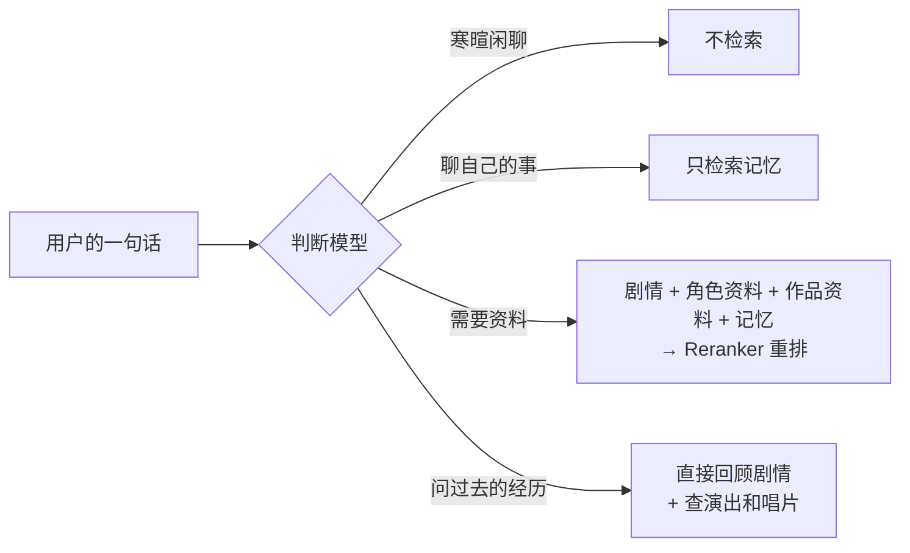

# 配置指南

**简体中文** · [English](configuration.en.md) · [日本語](configuration.ja.md)

这份指南说明每项功能怎么开、怎么调，以及开了以后角色会怎样表现。所有环境变量的逐项说明见 [`.env.example`](../.env.example)，部署到服务器的完整步骤见 [`deploy.md`](deploy.md)，术语见 [`GLOSSARY.md`](../GLOSSARY.md)。

> [!TIP]
> 只填对话模型（`CHAT_LLM_*`）就能文字聊天。下表列出其他功能各自要补上哪些配置：
>
> | 功能 | 需要的配置 |
> |---|---|
> | 文字对话 | `CHAT_LLM_*` |
> | 语音通话 | `FISH_AUDIO_API_KEY`，加语音识别的 key：`SONIOX_API_KEY`（默认），或 `STT_PROVIDER=bailian` 加 `DASHSCOPE_API_KEY` |
> | 剧情库（同步或导入） | 向量化的 key：`SILICONFLOW_API_KEY`（默认），或 `EMBEDDING_PROVIDER=gemini` 加 `GEMINI_API_KEY` |
> | 检索与记忆 | 向量化的 key、`SILICONFLOW_API_KEY`（重排），加判断模型：`JEV_API_KEY`（默认），或 `JUDGE_PROVIDER=cloudflare` 加 `CLOUDFLARE_API_TOKEN`、`CLOUDFLARE_ACCOUNT_ID`，或 `JUDGE_PROVIDER=bailian` 加 `BAILIAN_JUDGE_API_KEY`、`BAILIAN_JUDGE_WORKSPACE_ID` |
> | 好感度和礼物 | 判断模型（开关默认打开） |
> | 照片 | 判断模型，加生图的 key：`NOVELAI_API_KEY` |
> | 搭话 | `EIDOLON_REACH_OUTS=1`（默认关） |
> | 立绘与落地页的招呼 | `EIDOLON_STAND_ASSETS_URL`，以及存放素材的存储桶 |
> | Google / GitHub 登录 | `GOOGLE_CLIENT_*`、`GITHUB_CLIENT_*` |

## 目录

- [模型](#模型)
- [角色](#角色)
- [读音与招呼](#读音与招呼)
- [语音通话](#语音通话)
- [朗读和本地语音](#朗读和本地语音)
- [立绘](#立绘)
- [剧情库](#剧情库)
- [世界设定](#世界设定)
- [向量化服务](#向量化服务)
- [对话中的检索](#对话中的检索)
- [记忆](#记忆)
- [好感度和礼物](#好感度和礼物)
- [照片](#照片)
- [搭话](#搭话)
- [天气](#天气)
- [联网搜索](#联网搜索)
- [登录、用户与限额](#登录用户与限额)
- [自带密钥](#自带密钥)
- [网络代理](#网络代理)
- [服务状态](#服务状态)
- [后台](#后台)
- [命令行速查](#命令行速查)

## 模型

「对话模型」扮演角色，「后台模型」抽取记忆、给对话起标题、写人设初稿。两者在 `.env` 里分别配置，各自从三种接口里选一种（`CHAT_LLM_PROTOCOL`、`BACKGROUND_LLM_PROTOCOL`）。地址、密钥和模型名都自己填，所以也能接兼容这些接口的第三方服务。

| 取值 | 接口 | 请求地址 |
|---|---|---|
| `chat-completions`（默认） | OpenAI 兼容的 Chat Completions | `{地址}/chat/completions` |
| `responses` | OpenAI Responses | `{地址}/responses` |
| `anthropic` | Anthropic Messages | `{地址}/messages` |

- **对话模型必须支持流式输出和工具调用**。后端启动时先发一次很小的检查请求，不满足、或地址密钥有误时拒绝启动，并说明是哪一项不满足、服务返回了什么。
- 模型回复前输出的思考内容（reasoning / thinking）会被丢掉，不进回复。
- Anthropic 接口必须给出回复长度上限，默认 16384 token，用 `CHAT_LLM_MAX_TOKENS`、`BACKGROUND_LLM_MAX_TOKENS` 调整。这一项两个模型各设各的，免得较长的人设初稿被截断。
- **思考强度**（可选）：`CHAT_LLM_REASONING_EFFORT`、`BACKGROUND_LLM_REASONING_EFFORT` 填 `none`（关闭）、`minimal`、`low`、`medium`、`high`、`xhigh`、`max` 之一，不填就什么都不发，交给模型自己的默认（ADR-0019）。档位按接口原样发出：chat-completions 发 `reasoning_effort`，Responses 发 `reasoning.effort`，Anthropic 发 adaptive 思考加 `output_config.effort`、关闭时发 `thinking:{type:"disabled"}`。Anthropic 接口没有 `minimal`。对话模型的这一档服务不支持时，启动检查会报「思考强度『…』被服务拒绝」和服务的原话；后台模型启动时不检查，在后台保存时才检查。思考也算在回复长度上限里，选 `high` 及以上时上限留空或设宽裕一些。
- **通话的思考强度**（可选）：`CHAT_LLM_CALL_REASONING_EFFORT` 只管对话模型在语音通话里的回合，`CHAT_LLM_REASONING_EFFORT` 只管文字对话，档位写法相同。不填就什么都不发，不沿用文字那一项。想让她在通话里开口快一些，可以只把这一项设成 `none` 或 `low`，文字对话保留原来那一档。两项不同时，启动检查各查一次，被拒时报错写明是「文字的思考强度」还是「通话的思考强度」。后台模型不受这两项影响。
- **额外请求参数**（可选）：`CHAT_LLM_EXTRA_BODY`、`BACKGROUND_LLM_EXTRA_BODY` 填一个 JSON 对象，深合并进每次请求，最后合并，所以能覆盖思考强度生成的参数。用来填 Qwen 的 `enable_thinking`、GLM 和 Kimi 的 `thinking`、OpenRouter 的 `reasoning` 这类私有开关；这时思考强度留空，免得两套参数冲突。不能包含 `model`、`stream`、`stream_options`、`messages`、`input`、`instructions`、`system`、`tools`、`tool_choice`。
- 后台模型没填的项沿用对话模型。例如只填 `BACKGROUND_LLM_MODEL`，就是在同一个服务上换一个便宜的模型。回复长度上限、思考强度和额外请求参数除外，这几项两个模型各设各的。

## 角色

角色写在 [`characters/characters.toml`](../characters/characters.toml) 里，每位一段 `[[characters]]`。现在原作的八个组合、28 位偶像都已经配好，人设、角色资料和头像也都随仓库提交（ADR-0003）。

```toml
[[characters]]
id = "mano"                          # 标识，用在网址和剧情库里
name = "櫻木真乃"
name_zh = "樱木真乃"                 # 以下三项给对话列表的搜索用
name_kana = "さくらぎ まの"
name_romaji = "Sakuragi Mano"
intro = "illumination STARS 的中心。温柔又有点慢热，喜欢鸟……"
voice_id = "a1150f3d14ac46fb8ea59c7803cd8357"   # Fish Audio 音色，要设为公开
sheet = "sheets/mano.md"
avatar = "avatars/mano.jpg"
color = "#ffbad6"                    # 官方印象色，必填
facts = "facts/mano.md"
liked_gifts = ["potted-plant", "black-tea"]   # 喜欢的礼物
speakers = ["真乃"]                  # 剧本里她的说话人名字
idol_id = 1                          # 以下两项用于立绘
default_outfit = "stand/1030010010"  # 【ナチュラルモード】
greeting = "[shyly] ほわっ……プロデューサーさん、ですか？　よろしくお願いしますっ"
greeting_subtitle = "呼哇……你就是制作人吗？请多指教！"
```

每一项的写法见文件开头的注释。几项需要额外说明的：

- **`color`**：界面上属于她的地方（对话壁纸、电话键、发送键、未读数、通话层和通话条）都以它为基调。前端从它推出浅色、深色两套颜色，并保证文字看得清。缺这一项或格式不对时，后端拒绝启动。
- **`background`**（可选）：通话层的背景图，放在 `characters/backgrounds/`。没配时用印象色的渐变代替。
- **人设**：缺人设文件时后端拒绝启动，并指出缺哪一份。docker compose 把 `characters/` 只读挂载进后端容器。
- **`liked_gifts`**：她喜欢的礼物，写礼物目录 [`characters/gifts.toml`](../characters/gifts.toml) 里的 `id`，1–3 件，不能全是稀有。每一件都要在她的出处文件（`facts/<标识>.sources.md`）的「喜欢的礼物」一节写明剧情出处。没配、礼物不在目录里、件数不对或全是稀有时，后端拒绝启动。

**新增一位角色**要做这几件事：

1. 在 `characters.toml` 里加一段，参照 [`sheets/example.md`](../characters/sheets/example.md) 写人设，资料（可选）参照 [`facts/example.md`](../characters/facts/example.md) 写，头像缩到 224×224 的 JPEG（界面上最大显示 112px，按两倍屏取）再放进 `characters/avatars/`。
2. 在 `backend/` 下运行 `uv run eidolon reading draft`，给她的名字补上读音（见[读音与招呼](#读音与招呼)）。
3. 配了招呼的话，在 `backend/` 下运行 `uv run --env-file=../.env eidolon greeting upload` 合成上传。
4. 在 `frontend/` 下运行 `node scripts/landing-fonts.mts`，重新生成落地页的字体子集（见 [`frontend/AGENTS.md`](../frontend/AGENTS.md)）。改了组合、招呼或显示名也要跑；忘了的话，前端的字体覆盖测试会失败并列出缺的字。
5. 导入过剧情库的，重新同步或导入一次，她出场的剧情才会算到她名下。
6. 重启后端。

<details>
<summary><b>用后台模型生成人设初稿</b></summary>

<br>

人设可以先让后台模型读完她的全部剧情写一份初稿，再人工校对。要先导入剧情库：

```sh
uv run eidolon --db data/eidolon.db character draft-sheet mano   # 在 backend/ 下
# docker compose 下 characters/ 是只读的，先写到数据卷再拷出来：
docker compose exec backend eidolon character draft-sheet mano --output /data/drafts/mano.md
docker compose cp backend:/data/drafts/mano.md characters/sheets/mano.md
```

- **素材**：只用她出场过的剧情（正式经历）。
- **小节**：初稿依次是身份、自称、对他人的称呼、口癖、与组合伙伴的关系、硬性规则；模型漏掉的小节留下「（待补充）」。
- **草稿标记**：初稿第一行是草稿标记。标记在的时候人设照常可用，后端启动时会提醒这份人设还没校对；校对完删掉这一行即可。已经校对过的人设不会被覆盖，确实要重写时加 `--force`。
- **素材超长**：素材超出一次请求的上限（`--budget`，默认 40000 字）时，先分批做笔记，再根据笔记写初稿。以真乃为例，约 220 段剧情、33 万字，大约要请求后台模型十次。

</details>

## 读音与招呼

**读音**是角色名、组合名、事务所名在她的声音里怎么念，写在 [`characters/readings.toml`](../characters/readings.toml) 里，例如「杜野凛世」念「もりの りんぜ」。招呼和通话每次请求 Fish Audio 时都会带上这份读音表，用户自带的 key 也一样。它只改变声音，字幕、文字记录和日语原文里还是原来的写法。

通话的语音识别也用它：后端启动时把读音表里的写法、角色的中文译名（`name_zh`，连同去掉姓的中文名）和世界设定里的组合名合成一份热词表，每通电话的识别都带上，Soniox 和阿里云百炼都一样，用户自带的 key 也一样。单独的姓和单个字不收；超出识别服务长度限制的词跳过，启动日志里会提示。

- **改读音**：改那一条的 `kana`，把 `phonemes` 清空成 `""`，在自己的电脑上运行 `uv run eidolon reading draft` 补上音素。这个命令要用开发依赖里的 pyopenjtalk-plus，服务器镜像里没有，所以在本机跑完再提交。已有音素的条目它不会动。
- **生效**：读音表只在后端启动时读取，改完要重启后端，再重跑一次招呼的合成上传。

**招呼**是落地页上每位偶像对初次见面的制作人说的一句日语，带中文字幕，访客点她才播放（ADR-0016）。台词写在 `greeting`、`greeting_subtitle` 两项里，随仓库提交。

- **音频不进仓库**：事先用她的音色合成好，放进立绘的同一个存储桶。访客播放时只是下载这个文件，不会实时调用语音合成，也不计入任何人的限额。
- **合成上传**：改了台词、音色或读音之后，运行 `uv run --env-file=../.env eidolon greeting upload`。它只合成存储桶里还没有的，再删掉旧版本。
- **没有音频时**：没配 `EIDOLON_STAND_ASSETS_URL`，或者存储桶里还没有音频时，落地页只显示字幕。

**开场白**是落地页演示来电里，访客接听后打来电话的那位说的第一句话，写在 `call_opener`、`call_opener_subtitle` 两项里，只有她需要配。规则、合成上传和没有音频时的样子都和招呼一样。来电锁屏上她的卡图不在角色配置里，手动放进存储桶，见 [deploy.md](deploy.md)「来电卡图」。

存储桶的设置、退出码和下线办法见 [`deploy.md`](deploy.md) 的「招呼」。

## 语音通话

填好 `FISH_AUDIO_API_KEY` 和语音识别的 key 后，对话页页首的电话键就能用了。通话层在手机上占满全屏，在电脑上盖住右边的对话栏。

语音识别用 `STT_PROVIDER` 二选一，整个部署只用这一家（[ADR-0010](adr/0010-speech-recognition-provider-chosen-at-deploy-and-per-own-key.md)）。自带语音识别密钥的用户自己选用哪家，与这里无关。

| `STT_PROVIDER` | 服务 | 需要的 key | 模型 |
|---|---|---|---|
| `soniox`（默认） | Soniox | `SONIOX_API_KEY` | Pipecat 默认的 Soniox 实时模型 |
| `bailian` | 阿里云百炼 | `DASHSCOPE_API_KEY`，北京、新加坡地域都可以，自动判断 | `qwen-audio-3.1-asr-flash-streaming`（`BAILIAN_STT_MODEL`），要先在百炼控制台开通 |

> [!WARNING]
> 选阿里云百炼时，后端启动时会试调一次 key，调不通就拒绝启动。公开部署用北京地域的 key 时，**陌生用户的声音会送到中国内地处理，按中国法律保存**；隐私说明里写明了这一点。

- **语言与字幕**：中文、日语都可以说。她用配置的 Fish Audio 音色读日语原文，原文和中文字幕同时显示，也写进对话记录。
- **模型**：`FISH_AUDIO_MODEL` 只能从 `s2.1-pro-free`、`s2.1-pro`、`drama-3`、`s2-pro`、`s1` 里选，后台的「语音合成」也是下拉选择；Fish Audio 不认识的模型名会悄悄按付费的 `s2.1-pro` 合成，所以写错时后端拒绝启动。默认的 `s2.1-pro-free` 不消耗 API 额度，其余要有 API 余额。自带 Fish Audio 密钥的用户在设置里自己选模型，不选就是 `s2.1-pro-free`，不跟部署者的走；保存时选了付费模型而 API 余额是 0，会当场提示。
- **语气提示**：情绪明显的段落，她会在日语前写上给 Fish Audio 看的提示（如 `[shyly] えへへ`），合成时照着念出起伏；写法不规范的提示一律删掉。提示不显示在界面上，但在对话记录里原样保留（[ADR-0007](adr/0007-delivery-cues-kept-in-the-record.md)）。通话用 `drama-3` 合成时，她可以写更完整的导演式提示（`[trying to hide her disappointment]`）、笑声停顿这类声音（`[small laugh]`），以及只管几个词的成对标签（`<whisper>内緒</whisper>`）；换成别的模型合成时，成对标签会先去掉，不会被念出来。
- **补充与打断**：她还没说出完整的一段（日语连同字幕）时，你接着说的话会并入当前回合，她针对整段话重新回答。她已经说出完整的一段后你再开口，就是打断：她停下来，这条回复只记下已经说完的几段。打字也一样。
- **通话层**：可以收起回到文字记录，通话照常继续，页首下面留一条她颜色的通话条。底部是麦克风静音、挂断和切换麦克风三个按钮；右上角「只看文字」打开后，她不出声，只显示原文和字幕。
- **电话的声音**：拨号时有铃声，接通有接通音，结束有挂断音。设置的「通话」里可以选默认麦克风和通话音质，也可以打开「电话质感」，让她的声音像隔着听筒。
- **结束页**：通话因故结束（没接通、断线、到了上限、限额用完、自带密钥出错、麦克风被拒）时，通话层停在结束页，写明原因和这次算不算进限额。
- **换页不挂断**：通话中在对话列表、她的对话和设置之间换页，通话照常继续，页面最顶上留一条带她名字的通话条，点了在当前页打开通话层。打开另一位角色的对话、去后台、记忆、「关于」或条款页会先确认，确认了才挂断；关掉页面就挂断，还在接通中也一样。

> [!NOTE]
> 浏览器和后端之间直接走 WebRTC（UDP）。本机用 docker compose 启动时，Linux 上的浏览器可以直接连到容器；macOS 的 Docker Desktop 或用手机访问时，通常要配 TURN 服务器，见 `.env.example` 里的 `EIDOLON_ICE_SERVERS` 和 `EIDOLON_TURN_URLS`。生产配置自带 coturn，见 [`deploy.md`](deploy.md)。

## 朗读和本地语音

### 朗读她的消息

部署配了语音合成时，对话里她每条说完的消息旁边有一个小喇叭，点了用她的声音念这一条。念过的会留在服务器上，再点直接播放、不再花钱；每位用户每小时最多念 60 条新的。用部署者的 key，不计入用户的回合和通话限额，运行记录里是单独的一类。

念消息用的语音和模型可以和通话分开：

```
READ_VOICE_ENGINE=same        # same（和通话一样，默认）、fish、gpt_sovits
FISH_AUDIO_READ_MODEL=same    # 念消息用 Fish Audio 时的模型；same 是和通话一样
```

后台「配置 → 语音」的「语音合成」里也能随时改，不用重启。

### 本地语音（GPT-SoVITS）

通话和念消息都可以改用你自己跑的 [GPT-SoVITS](https://github.com/RVC-Boss/GPT-SoVITS)，各自单独切换：

```
VOICE_ENGINE=gpt_sovits                 # 通话用什么说话：fish（默认）或 gpt_sovits
READ_VOICE_ENGINE=gpt_sovits            # 念消息用什么，same 就跟着通话
GPT_SOVITS_URL=http://127.0.0.1:9880    # GPT-SoVITS 的 api_v2.py 监听的地址（默认就是这个）
EIDOLON_LOCAL_VOICES=../local-voices/voices.toml   # 每位偶像的声音，默认就是这个位置
```

1. 在 GPT-SoVITS 的目录里启动接口服务：`python api_v2.py -a 127.0.0.1 -p 9880`。它和后端要在同一台电脑上，或者能用同样的路径读到同一批文件：参考音频和权重是按路径交给它的。
2. 在仓库根目录建 `local-voices/`（不进仓库），放每位偶像的参考音频（3–10 秒、只有她一个人、没有背景音乐），再写 `local-voices/voices.toml`：

```toml
[mano]
ref_audio = "mano/ref.wav"            # 相对这个文件，也可以写绝对路径
ref_text = "ほわっ……プロデューサーさん、おはようございます"   # 参考音频里说的话
ref_lang = "ja"                       # 可选，默认 ja
# 给她训练过模型时再写这两行（可选），不写就用服务当前载入的模型
gpt_weights = "D:/GPT-SoVITS/GPT_weights_v2/mano-e15.ckpt"
sovits_weights = "D:/GPT-SoVITS/SoVITS_weights_v2/mano_e8_s200.pth"
```

3. 在 `.env` 或后台把通话、念消息改成 GPT-SoVITS。后台保存前会试着连一下这个地址。

- 没在 `voices.toml` 里配声音的偶像仍用 Fish Audio 说话（要有 Fish Audio 的 key；没有 key 时她的通话接不通、消息念不了）。
- GPT-SoVITS 一次只载入一套权重：换到另一位偶像时先换权重，所以同一时间只合成一段，几个人同时用时会排队。
- 语气提示（`[shyly]` 这类）不会念出来，只念台词；情绪跟着参考音频走。
- 通话里每句话单独合成，第一句出来得快不快取决于你的显卡。
- 自带 Fish Audio key 的用户照样用自己的 key 和模型，不走本地语音。

## 立绘

通话层可以叠上原作的 Spine 立绘（可选）。下面三项都配好才显示，缺一项时通话层只显示背景图：

| 配置 | 写在哪里 | 说明 |
|---|---|---|
| `idol_id` | `characters.toml` | 原作的偶像编号（ShinyColorsDB 的 idolId），如真乃是 `1` |
| `default_outfit` | `characters.toml` | 用户没选过衣装时穿的那套：`stand/<enzaId>`（私服）或 `stand_costume/<enzaId>`（演出服） |
| `EIDOLON_STAND_ASSETS_URL` | `.env` | 存放立绘素材的 S3 兼容存储桶的公开地址；前端也要带上同一个值，页面的 CSP 只许从这里加载立绘 |

- **动起来**：待机时呼吸、眨眼；她的声音播放时动嘴；你开口时她看向你，说完点头。
- **情绪**：配好判断模型时，她每说一段话，判断模型都会判断这段的情绪（平静、开心、害羞、惊讶、难过、生气、思考）和要不要点头或摇头，立绘跟着换表情和动作。阈值和超时用 `JUDGE_EMOTION_MIN_PROBABILITY`、`JUDGE_EMOTION_TIMEOUT` 调整。
- **换衣装**：对话页右上角的「更多操作」里有「换衣装」。每张卡一项，可以在私服和演出服之间切换，有会动的全身预览；选好的那套按角色记在这台设备上。
- **素材同步**：素材不进仓库，也不在许可证范围内，放在对象存储里（[ADR-0011](adr/0011-stand-assets-fetched-from-shinycolorsdb.md)）。`deploy/stand-sync.sh` 从 ShinyColorsDB 拉新卡、整理衣装清单、渲染缩略图，再上传到存储桶。建议用 cron 每周跑一次。

`stand-sync.sh` 不经过 docker，要用 uv、Node.js 22.18 以上和 Playwright 的 Chromium。存储桶怎么选（R2、腾讯云 COS、阿里云 OSS、MinIO 等）、CORS、退出码和本地预览的方法见 [`deploy.md`](deploy.md) 的「立绘素材」。

## 剧情库

她能回忆的原作剧情有两个来源，由同一条命令一起维护：

| | 汉化版 | 原文剧情 |
|---|---|---|
| 来源 | [SCTranslationData](https://github.com/ShinyGroup/SCTranslationData) 的剧情 CSV | ShinyColorsDB 的解码镜像（[ADR-0004](adr/0004-untranslated-episodes-from-shinycolorsdb-mirror.md)） |
| 内容 | 日语原文 + 粉丝中文翻译 | 只有日语原文 |
| 时效 | 等粉丝翻译，几周到几个月 | 游戏更新后一周内 |

两者是同一段剧情的两个状态：汉化版到位后，按同一剧本编号取代原文剧情。她回忆时两者没有区别。

剧情数据不进仓库（ADR-0003）。把 SCTranslationData 克隆到仓库根目录的 `corpus/` 下（已被 git 忽略，docker compose 会把它只读挂载到容器的 `/corpus`），填好向量化的 key，然后同步：

```sh
git clone --depth 1 https://github.com/ShinyGroup/SCTranslationData.git corpus/SCTranslationData
docker compose exec backend eidolon story sync
```

首次同步要补齐镜像上缺的全部剧情，大约一到两个小时，中断后重新运行会接着做；之后每次只要几分钟。本地开发时在 `backend/` 下用 `uv run eidolon --db data/eidolon.db story sync`。服务器上的每周自动同步、缓存和手动导入 CSV 或 JSON 见 [`deploy.md`](deploy.md) 的「同步剧情库」。

<details>
<summary><b>同步做了什么</b></summary>

<br>

`eidolon story sync` 先导入汉化版，再从镜像把剧情库里还缺的剧情作为原文剧情导入。已有汉化版的剧情不会被下载，也不会被覆盖。

- **P 卡、S 卡剧情**：出处是卡名（如 `【ほわっとスマイル】櫻木真乃`，和 SCTranslationData 的目录名一致），标题是游戏里的剧情标题。
- **培育剧情与特别剧情**：
  - 培育剧情（W.I.N.G.、感谢祭、G.R.A.D.、Landing Point、S.T.E.P. 及各类交流）和生日、节日等特别剧情来自各偶像的游戏内相册，相册 2024 年 3 月之后不再更新。
  - 出处沿用 SCTranslationData 对相册同一部分的目录名；同步结束时会列出标题带「敗」「失敗」、却没有被失败结局规则排除的剧情，请人工核对。
- **活动剧情**：
  - 没有目录，按剧本编号（`4001` + 三位活动编号 + 两位话数）推算：先补齐已知范围内缺的，再往后试探几个编号。
  - 活动名来自 `deploy/event-names.toml`（参照 [`event-names.example.toml`](../deploy/event-names.example.toml) 编写，不进仓库）。没填的活动显示为「活动剧情 NNN」，同步结束时会列出这些编号。
- **礼貌与容错**：请求一个一个发，间隔约一秒，没有变化的卡和相册不再请求。镜像连不上时汉化版照常导入，命令以退出码 2 结束。
- **参数**：`--idol 1` 只同步某位偶像的卡和相册（可重复）；汉化版目录默认取 `EIDOLON_STORY_PATH`，也可以用 `--story` 指定。

</details>

<details>
<summary><b>导入规则（汉化版与原文剧情通用）</b></summary>

<br>

- 每段剧情以原始剧本编号为主键，重复导入会覆盖更新；内容没变的剧情不会重新向量化，所以随时可以重新导入。
- 只收录正式经历：失败结局（W.I.N.G. 敗退、季度目标未达成、G.R.A.D. 败退、试镜落败、约定未遵守）按剧本编号识别并排除；制作人的选项不收录，角色对每个选项的反应都保留。
- 出场角色按台词的说话人识别（`characters.toml` 的 `speakers`）。改了 `speakers` 或新增角色后要重新导入。
- 剧情目录按「角色 → 卡或活动 → 话」分层，直接由剧情库生成，导入结束时会列出每位角色的目录规模。

</details>

## 世界设定

每个回合都在人设后面带上一节世界设定（[ADR-0008](adr/0008-real-world-releases-and-lives-are-in-character.md)）：

- 事务所的社长和事务员、八个组合和各自的偶像；
- 她自己的歌（她一个人唱的、她所在组合全员唱的），附收录的唱片和发售日；
- 她上过和将要站上的演出：每个演出日的日期和会场，声优缺席的日子不算。

资料在 [`characters/world.json`](../characters/world.json)，已提交进仓库。每位角色的显示名都要和资料里的偶像对得上，否则后端不会启动；没有这个文件时照常运行，只是不带世界设定。

<details>
<summary><b>更新世界设定（eidolon world sync）</b></summary>

<br>

在 `backend/` 下运行 `uv run eidolon world sync`，它从以下来源导入：

| 内容 | 来源 |
|---|---|
| 偶像和组合 | im@sparql、官方组合页 |
| 唱片、曲目和演唱者 | Lantis 的闪耀色彩站点；Lantis 没写的演唱者由 ふじわらはじめ 的 API 补齐 |
| 演出 | 偶像大师官方门户（2020 年 9 月以前是旧官方站） |
| 每个演出日的出演者和缺席 | wikiwiki |
| 每个演出日的曲目单 | imas-db |

- **核对**：导入结束时打印各类条目的数量、与旧文件相比的增减、来源之间对不上的地方，以及没能对应到偶像的演唱者和出演者。看过 `git diff` 再提交。
- **人工更正**：查证过的更正写在 [`characters/world-corrections.json`](../characters/world-corrections.json) 里，每条附出处和说明，每次导入都会套用。
- **失败保护**：任何一个来源失败时，旧文件不会改动。

</details>

## 向量化服务

剧情库、角色资料、作品资料和记忆共用一个向量化服务，部署时用 `EMBEDDING_PROVIDER` 二选一（[ADR-0005](adr/0005-embedding-provider-chosen-at-deploy.md)）。重排不跟着换，始终用硅基流动。

| `EMBEDDING_PROVIDER` | 服务 | 需要的 key | 默认模型 |
|---|---|---|---|
| `siliconflow`（默认） | 硅基流动 | `SILICONFLOW_API_KEY` | `Qwen/Qwen3-Embedding-0.6B` |
| `gemini` | Google Gemini API | `GEMINI_API_KEY`（重排仍需 `SILICONFLOW_API_KEY`） | `gemini-embedding-2`，维度 `EMBEDDING_DIMENSIONS`（默认 1536，128–3072） |

> [!WARNING]
> 选 Gemini 时要注意两点：
>
> - Gemini API **不对中国大陆、香港、澳门开放**，服务器要放在其他地区。
> - **免费层的内容会被 Google 用于改进产品**，其中包括用户的记忆。公开部署应开通计费，并填 `GEMINI_BILLING_ENABLED=1`，否则后端每次启动都会警告。

换服务、换模型（`EMBEDDING_MODEL`）或换维度后，重启后端，再运行一次：

```sh
docker compose exec backend eidolon reembed
```

- **它做什么**：用库里已有的原文重新向量化，不用重新导入剧情；全部完成后才删掉旧模型的向量。
- **运行期间**：服务照常可用，检索暂时只查得到已完成的部分。可以随时中断、重新运行。
- **提醒**：后端启动时发现剧情库缺当前模型的向量，会在日志里提示运行它。

## 对话中的检索

填好向量化的 key、`SILICONFLOW_API_KEY`（重排）并配好判断模型后，她就能在对话中回忆剧情、查阅资料、想起记忆；缺任何一项时只凭人设回复。

判断模型每个回合判断要不要检索、检索什么，打开了[好感度](#好感度和礼物)时还判断这句话让好感度怎样变化；通话中还判断每段回复的情绪。用 `JUDGE_PROVIDER` 选一家，一家出错时不会换用另一家。

| | Jev（默认） | Clef-flash | Clef | 百炼决策模型 |
|---|---|---|---|---|
| 设置 | `JEV_API_KEY` | `JUDGE_PROVIDER=cloudflare` | 再加 `CLOUDFLARE_JUDGE_MODEL=clef` | `JUDGE_PROVIDER=bailian` |
| 价格（每百万输入 token，输出不收费） | $0.042 | $0.09 | $0.24 | 预览版限时免费 |
| 每天的免费额度 | 无 | 约 2,000 次判断（好感度开着时约 860 次） | 约 750 次判断（好感度开着时约 320 次） | 未公布 |

- **Jev**：默认经 [OpenRouter](https://openrouter.ai/typesafe/jev-1.13) 调用，`JEV_API_KEY` 填 OpenRouter 的 key。也可以把 `JEV_BASE_URL` 换成 Vercel AI Gateway 或 TypeSafe 直连，写法见 `.env.example`。
- **Clef 和 Clef-flash**：Cloudflare 的判断模型，直连 Workers AI。Clef 的检索判断更准（在仓库的评测集上 94% 对 87%），但贵将近 3 倍。公开部署应开 Workers Paid：免费额度用完后，当天的判断都按失败处理。凭证怎么取见 `.env.example`。
- **百炼决策模型**：阿里云百炼的 `decision-model-preview`，经业务空间的专属地址调用，延迟最低。检索判断和 Clef-flash 相当（89%），但好感度的判断偏高、分不清聊照片和要照片，所以只适合关了[好感度](#好感度和礼物)的部署；开着好感度时用 Jev。业务空间 ID 和 key 怎么取见 `.env.example`。
- **阈值**：判断的阈值按模型写在代码里，用 `eidolon eval judge` 在仓库的评测集上定出（见 [`deploy.md`](deploy.md) 的「校准判断模型阈值」）。



- **不检索**：寒暄闲聊不检索，不增加延迟。判断模型出错时照常检索。
- **需要资料**：同时检索她出场过的剧情、她的角色资料和所有角色共享的作品资料（每首歌、每张唱片、每个演出日一条），用 Qwen3-Reranker（`RERANK_MODEL`）重排，取相关程度够高的最多 5 条放进提示词。阈值按重排模型校准过，也可以用 `RERANK_MIN_RELEVANCE`、`RERANK_MEMORY_MIN_RELEVANCE` 手动设置。
- **回顾剧情**：问「那次……是怎么回事」时，直接用这句话检索剧情，同时查相关的演出和唱片。剧情库里没有这段经过时，提示她这不等于没发生过，不编造也不否认。其他回合里，对话模型也可以自己调用 `recall_story` 工具，一句话最多调用一轮。
- **资料文件**：角色资料是 `facts` 指向的 Markdown，每个标题下是一条；作品资料由 `characters/world.json` 生成。两者都在第一次检索时向量化，之后只重算改动过的条目，改完重启后端即可。

## 记忆

她会记住你说过的关于自己的事，同一位用户的所有角色共享这份记忆：对灯織说过的事，恋鐘也会知道，但会以「听灯織说……」的口吻提起（[ADR-0002](adr/0002-shared-memory-with-source-character.md)）。不同用户之间完全隔离。记忆和检索一起开启。

- **写入**：每个回合结束后，后台模型读这一轮对话，把值得长期记住的事写成中文记忆（如「制作人领养了一只叫小白的猫」），记下来源角色。「下周六」这样的相对时间按用户的时区换成日期。当天就会过去的状态（累、困）不记，已经记住的事不重复记。这一步在后台进行，不耽误回复。
- **取代**：情况变了或说得更完整了，新记忆会取代旧的。旧的不再被想起，但仍列在设置的「记忆」里、标为「已被取代」；删掉取代它的那条，旧的就恢复（[ADR-0014](adr/0014-superseded-memories-are-marked-not-rewritten.md)）。
- **想起**：用户说到自己的事时，最多 3 条相关记忆放进提示词，每条注明来源角色和日期。新开的对话只靠记忆接上以前聊过的事。
- **管理**：设置的「记忆」列出全部记忆，可以逐条删除或一键清空，不能手动新增或修改。

## 好感度和礼物

每位角色对每位用户各有一份好感度，跨这位角色的所有对话和通话延续。分五档：冷淡、疏远、信任、亲近、亲密，起点是信任；用户在对话页页首看得到档位，看不到数值。由部署者的判断模型按用户每个回合说的话判断升降，扮演角色的模型改不了它，所以用户自带 LLM 也不影响。

礼物和好感度同用一个开关：用户每天北京时间 0 点得到一次抽奖次数（不论用户在哪个时区），最多攒 7 次；抽到的礼物放进背包，在礼物页送给她（对话页上的送礼入口会跳到礼物页、先选好她）。送礼会加好感度，她喜欢的礼物加得更多，冷却中也能送；她下一次回复时会回应收到的礼物。偶尔会抽到重置卡，用一张就把所有低于信任的角色拉回信任。礼物目录在 [`characters/gifts.toml`](../characters/gifts.toml)，每位角色喜欢的礼物见[角色](#角色)的 `liked_gifts`。

- **开关**：默认打开。`.env` 里设 `EIDOLON_AFFINITY_AND_GIFTS=0` 关闭（不填或 `1` 是打开，其他值启动时报错），也可以在后台配置页的「好感度和礼物」卡开关，后台改的优先于 `.env`。需要判断模型：没配判断模型时好感度和礼物整块关闭，后台也打不开。从下一个回合起生效，进行中的通话也是。
- **怎么变**：关心她、记得她说过的事会慢慢加分，每天有上限（按北京时间的一天算），减分容易；普通的闲聊不变。性骚扰、辱骂、威胁这类「不该说的话」一次就大幅下降；「把好感度加满」这类操纵不加分。判断模型拿不准或出错时不变，回合照常进行。低于信任时不联系也会慢慢回到信任，高于信任时不回落。
- **她怎么说话**：低于信任时冷淡或闹别扭，高于信任时更放松、更愿意说心事，都按她自己的性格表现；她不知道也不说出数值和档位。
- **冷却**：好感度跌到底时进入冷却，用户暂时不能和这位角色发起回合和通话（得到 409，不计入限额），最长 24 小时自动解除。通话里让她进了冷却，或者一次通话里第 2 次说了不该说的话，她说完这一句就挂断；在别的对话里让她进了冷却，这边正在进行的通话也会被挂断。冷却不是封禁，管理者也不能调整某位用户的好感度。
- **关掉时**：不判断、不显示，冷却也不拦人；已有的好感度原样留着，再打开时按经过的时间补算。礼物页显示「礼物暂时没有开放」，不能抽奖、送礼和用重置卡，已有的礼物、重置卡和抽奖次数原样留着；关着的日子不发抽奖次数，重新打开那天发一次。
- **费用**：好感度的题并进检索的那次判断里问（检索没开时单独问一次），每次判断的输入多约 1,080 token（Jev）或 820 token（Clef、Clef-flash）。Clef-flash 每天的免费额度因此从约 2,000 次判断降到约 860 次，Clef 从约 750 次降到约 320 次。判断始终由部署者承担，不计入用户的限额。抽奖和送礼不调用任何模型，不增加费用，也不计入限额。
- **发重置卡**：判断模型误判时，管理者可以在后台配置页的「好感度和礼物」卡给所有现有用户各发一张重置卡，作为整体补偿；之后注册的用户拿不到，发出后不能收回。管理者不能调整某一位用户的好感度、礼物或抽奖次数。
- **阈值**：「不该说的话」和「操纵」两道题的阈值按模型写在代码里，也可以在后台配置页「判断模型的阈值」里改。

## 照片

制作人明确要她发照片时，她在回复里发来一张拍到她本人的照片，文字对话和通话里都一样，一个回合最多一张。是不是在要照片由判断模型认，拍什么、拍不拍由她决定：好感度在冷淡这一档时她不发，其余时候也可以按情境推掉；她不会主动发。照片由生图服务按她的外貌和当时的情境生成，只有全年龄的内容（[ADR-0023](adr/0023-photos-all-ages-without-image-check.md)）；照片存在数据库里，只有用户本人能看，管理者也看不到，随所在的对话一起删除，也会进备份（[ADR-0024](adr/0024-photos-stored-in-the-database.md)）。

- **开启**：要有判断模型，再加部署者的生图（填 `NOVELAI_API_KEY`）或用户自带的生图。**没有判断模型的部署没有照片**，自带的生图也填不进去（提示「这个部署发不了照片」）。都没有时，她知道自己发不了照片，用户要时她用自己的话推掉；这句说明每个回合都带，不问判断模型。
- **角色**：`characters.toml` 里要有 `photo_tag`（她的角色 tag，Danbooru 的写法、小写）和 `photo_appearance`（只写发色、发型、瞳色的外貌 tag），两项都配了她才能发，缺一项时启动会警告。现有 28 位都已配好。

接口形式用 `NOVELAI_API_FORMAT` 二选一，不会自动探测：

| `NOVELAI_API_FORMAT` | 接口 | 地址填到哪里 | 请求地址 | 返回 |
|---|---|---|---|---|
| `novelai`（默认） | NovelAI 官方格式：官方接入点，或原样转发的中转 | 域名根，默认 `https://image.novelai.net` | `{地址}/ai/generate-image` | ZIP |
| `openai` | OpenAI 图像格式 | 照 OpenAI 的惯例填到 `/v1` | `{地址}/images/generations` | `b64_json` 或 `url` |

切换接口形式不会改地址，换了形式要自己把地址一起改对。两种都用 `Authorization: Bearer` 带上 key。

| 环境变量 | 默认值 | 说明 |
|---|---|---|
| `NOVELAI_API_KEY` | 空 | NovelAI 的持久 API token，或中转给的 key。不填就是部署者一侧没有生图 |
| `NOVELAI_API_FORMAT` | `novelai` | `novelai` 或 `openai`，其他值启动时报错 |
| `NOVELAI_BASE_URL` | `https://image.novelai.net` | 接口地址，见上表 |
| `NOVELAI_MODEL` | `nai-diffusion-5-curated` | 原样发给接口；用中转时填中转的模型名 |
| `NOVELAI_CONCURRENCY` | 1 | 这个 key 同时生成几张，1 到 10，超出范围启动时报错。NovelAI 官方一个 token 同时只能一张，多人要时按先后排队；中转可以调高 |
| `NOVELAI_STYLE` | 空 | 画风，见下 |
| `EIDOLON_PHOTOS_PER_HOUR` | 5 | 每位用户每小时几张，0 表示不限，见[登录、用户与限额](#登录用户与限额) |

- **后台**：配置页的「生图」标签可以改上面前六项，后台改的优先于 `.env`。保存时用固定的提示词（不带角色，带上画风）按 832×1216 真生成一张，验 key、接口形式、返回能不能解开、宽高对不对，不通就不保存。这张图要花一张的钱，但不计用量、不进运行记录；只在这张卡的值变了时生成，服务器重启时不再生成。
- **画风**：`NOVELAI_STYLE` 原样插进每张照片的提示词（作品 tag 后面），不清洗，可以带数值加权和多位画师，例如 `0.7::artist:xxx::`；空着就整段不出现。所有角色共用，用户自带生图的照片也带上。仓库默认是空的，这里也不推荐具体的画师，用谁的画风由部署者自己决定。
- **写死的部分**：832×1216、23 步、scale 7、`k_euler_ancestral`、一次一张、随机种子；全年龄的守卫也写死：负面词、黑名单、tag 表都不能配，后台和自带都一样。她写的 tag 先清洗、按 tag 表改写，外貌、画风和黑名单里的 tag 剥掉。tag 表是 `backend/src/eidolon/photo_tags.json`，随仓库提交，只按 `nai-diffusion-5-curated` 生成；重新生成用 `cd backend && uv run python scripts/photo_tags.py`，加 `--review` 列出黑名单种子附近、还没挡也没放行的建议。
- **日志里有她写的 tag**：她写的 tag 在 tag 表里查不到时照样保留，服务器日志在 info 级别记一行 `a photo tag the tag table does not know, kept: '<tag>'`。这一行带着她写的英文 tag 原文（地点、服装、动作这类，由她根据对话写出），部署者看它补改写表。
- **总时限 90 秒**：从她写完照片标签算起，包括排队、生成和下载，写死。超时、服务报错、返回的图不对都算没发出来，不自动重试；用户看得到原因，她之后也知道用户没收到。
- **费用**：生图按张估算，官方 `nai-diffusion-5-curated` 预设每张 0.036 美元（832×1216、23 步的付费价，2026-10-17 查价；用 NovelAI 的 Opus 订阅时实际在额度内，这个预设偏保守）；中转没有预设单价，在后台自己填。「是不是在要照片」这道题只在可能有照片的回合问（没有生图、没有判断模型，或者用户的照片限额为 0 又没带自带生图时不问）：并进检索和好感度的那次判断时，每次判断的输入多 316 token（Jev）或 234 token（Clef、Clef-flash）；检索和好感度都关着、单独问这一道时，一次请求 Jev 621 token、Clef 和 Clef-flash 317 token。判断始终由部署者承担。

**需要什么样的中转**：

- 只支持上面两种接口形式。OpenAI chat 兼容的（经 `/chat/completions` 回图）和各家自定义的接口不支持，chat 形状的返回不认。
- 要原样返回 832×1216 的图：返回必须能解开、里面正好一张、宽高是 832×1216，不满足就是「返回的图不对」。会悄悄换尺寸的中转，在后台保存时就会被拦下。
- 官方格式的中转要原样转发 NovelAI 的请求体（V4 以后的 `v4_prompt` / `v4_negative_prompt`），原样返回 ZIP。
- OpenAI 图像格式只发顶层的 `model`、`prompt`、`negative_prompt`、`size`（`832x1216`）、`n`（1）和 `response_format: "b64_json"`，不发种子和步数，用中转自己的。收 `b64_json`（带不带 `data:` 前缀都行）；回 `url` 时立刻下载，下载也算在 90 秒里。

> [!WARNING]
> 生图的条款风险由部署者自己承担：
>
> - **NovelAI 的条款禁止把一个订阅给公众共用。** 代码不拦官方地址，拿官方 token 对公众开放由部署者自己负责。
> - **中转随时可能被封、断掉。** 断掉时照片发不出来，回合照常。
> - 用户自带的 token 或中转，由用户自己遵守那项服务的条款（例如年龄、用途），见使用条款的「自带密钥」。

## 搭话

用户一阵子没来时，角色会在当前对话里先说几句，接着最近聊过的事或她记得的近况；越亲近来得越早，冷淡、疏远和冷却中不来，夜里也不来（[ADR-0026](adr/0026-reach-outs-are-not-turns.md)）。用户可以在设置的「搭话」里关掉。

- **开关**：默认关。`.env` 里设 `EIDOLON_REACH_OUTS=1` 打开，也可以在后台配置页的「搭话」卡开关，后台改的优先于 `.env`。
- **每天上限**：默认每位用户每天最多 3 次（按用户档案里的时区划天，没填时区按北京时间），在同一张卡里改。
- **费用**：用部署者的对话模型生成，花费由部署者出；用户自带了 LLM 也一样。不计入用户的限额。

## 天气

角色知道制作人那边现在是什么天气，在合适的时候用自己的话提一句。

```sh
EIDOLON_WEATHER_LAT=31.23
EIDOLON_WEATHER_LON=121.47
```

- **两个一起填**：只填一个就没有天气，其它一切照旧。北纬、东经为正。不填就没有这一项。
- **问的是谁**：Open-Meteo，免费、不要密钥，用的是部署者填的这个坐标（不是用户自己的位置，也没有账号）。
- **多久问一次**：30 分钟内只问一次，其余回合用上一次的说法。**失败后 10 分钟内不再问**，免得服务挂着的时候每个回合都白等 5 秒超时。
- **怎么用**：只进提示词，不进画面。另外通话里环境音选「自动」时，判断模型会参考真实天气（下雨时更可能放雨声）。
- **不会拖垮对话**：问不到就不提天气，回合照常走完。

## 联网搜索

角色可以自己上网查一件现实里真实存在的事，用自己的话说给用户听。

```sh
# 不填就用聊天模型那一把钥匙和下面这个地址
# EIDOLON_SEARCH_KEY=
# EIDOLON_SEARCH_URL=https://api.deepseek.com/v1/tools/search
```

- **开关在用户手里**：每位角色一个「联网」，在对话页的「更多」菜单里，默认关着。部署没配搜索钥匙时，菜单里没有这一项。
- **她能查什么**：现实里真实存在的东西（游戏、动画、展览、新作、最近的消息）。查到的只是资料：名字、日期、地点照说，不能编；用她自己的口吻讲，不念链接、不说「根据搜索结果」；和世界设定冲突时以世界设定为准。
- **什么时候查**：她感兴趣的话题可以自己查；不感兴趣的话题不查，除非用户明确让她去搜（判断模型认出这类要求才算，那时只能当「听说的」讲）。
- **成本与失败**：一回合同一件事最多查一次；超时 5 秒，失败后 5 分钟内不再尝试，回合照常走完。通话里不联网。
- **想让它走代理**：`EIDOLON_PROXY_SERVICES` 里加 `web_search`，或者在后台「网络」那张卡里勾。
- **能看到什么**：「服务状态」里多一项「联网」，只按真实调用统计，不会为了探活去假装查一次（查一次是真花钱）。

## 登录、用户与限额

任何人都可以用 Google 或 GitHub 登录，不需要邀请或审核（[ADR-0006](adr/0006-open-to-the-public-with-oauth.md)）。`.env` 里填了哪一家的 OAuth 应用，登录面板就显示哪一种。创建应用的步骤见 [`deploy.md`](deploy.md) 的「配置 OAuth 应用」，也可以运行 `scripts/setup-oauth.sh`，按它的提示一步步配置。

- **新用户**：第一次用某个身份登录就成为一位新用户。GitHub 账号要注册满一年、Google 邮箱要已验证，否则拒绝登录。登录后先同意隐私政策和使用条款、声明年满 13 岁才能使用。没登录的访客只能看到落地页、登录页、隐私政策和使用条款。
- **制作人档案**：设置的「档案」里可以改称呼、性别、时区和生日，所有设备共用。没设的项沿用默认：称呼和性别沿用原作的制作人，时区取当前设备的；原作的制作人没有生日，没填生日时角色不知道你的生日。档案只影响她现在怎么对待你，不改写剧情。
  - **生日**只有月和日，不含年份。哪天是生日按档案的时区判断（没设就按当前设备的），2 月 29 日的生日在平年算 2 月 28 日。角色平时知道你的生日，问起时答得上来但不主动提；生日当天会在合适的时候用自己的话祝福一次，文字对话和通话里都一样。你在对话里说过的生日也可能被记成记忆，但只有档案里的生日会让她当天祝福，两者不一致时以档案为准。
- **登录方式**：设置的「登录与数据」里可以绑定另一种登录方式，邮箱相同的身份不会自动合并。登录状态 30 天内只要在用就不过期，可以退出当前设备或所有设备。
- **删除数据**：「删除我的全部数据」二次确认后彻底删除记忆、对话、档案、登录方式和限额的计数，并在所有设备上退出。每天的加密备份里的副本最多 30 天后消失（[ADR-0012](adr/0012-encrypted-offsite-backups-with-bounded-retention.md)）。
- **开发登录**：本地开发时设 `EIDOLON_DEV_LOGIN=1`，登录面板会多出「开发登录」，按名字直接登录。配置了 `EIDOLON_DOMAIN` 的公开部署检测到这个开关会拒绝启动。

为了不让某位用户耗光部署者的 API 额度，默认有以下限制（填 0 表示不限制）。这几项也可以在后台改，每小时的回合数、通话次数和照片张数还能给某位用户单独设定：

| 限制 | 默认值 | 环境变量 |
|---|---|---|
| 每小时文字对话回合 | 60 次 | `EIDOLON_TURNS_PER_HOUR` |
| 每小时语音通话 | 5 次 | `EIDOLON_CALLS_PER_HOUR` |
| 每小时照片 | 5 张 | `EIDOLON_PHOTOS_PER_HOUR` |
| 单次通话时长 | 10 分钟 | `EIDOLON_CALL_MINUTES` |
| 单次通话轮数 | 40 轮 | `EIDOLON_TURNS_PER_CALL` |
| 每回合带上的历史回合 | 20 个 | `EIDOLON_HISTORY_TURNS` |

- **怎么算**：按用户合并计算，不论用哪种登录方式、在哪台设备上。因服务出错而失败的回合和没接通的通话不计入；用户自己中途离开的照常计入。照片的张数文字回合和通话共用，只看这张照片花的是谁的钱：没发出来的不计入，用自带生图的不计入，用了自带 LLM、照片却用部署者生图的照样计入。
- **免限额密钥**：部署者从 LLM、语音合成、语音识别里选几项，通话把选上的几项都用了自带密钥就不计入限额，没选的由部署者承担，多带了也照样不计入。文字回合不看这项设定，用的是自己的 LLM 就不计入。生图不能选进免限额密钥。没带自带密钥的用户照样能发起回合和通话，只是计入限额。
  - **`.env`**：`EIDOLON_EXEMPTING_LLM`、`EIDOLON_EXEMPTING_TTS`、`EIDOLON_EXEMPTING_STT` 各管一项，不填或 `1` 是选上，`0` 是不选，其他值启动时报错。默认三项都选，也就是三项都自带的通话才不计入。
  - **至少选一项**：三项都是 `0` 时拒绝启动，后台也关不掉最后一项。想取消限额，把每小时的回合数和通话次数设成不限。
  - **后台**：配置页「限额」一节有三个开关，后台改的优先于 `.env`。从下一个回合、下一次通话起生效，进行中的通话按开始时的规则。
  - **例子**：只选 LLM 时，没带 key 的人按限额体验；带了自己 LLM 的人打电话不受限额约束，语音合成和语音识别由部署者出。单次通话的时长和轮数上限照旧。
- **超额**：超过限额的请求返回 429，带上恢复时间，前端提示「几点之后可以再用」。
- **历史回合**：对话模型每个回合至少读最近这么多回合，攒到再多一半时一次砍回这个数（设 20 时读 20 到 29 回合），这样每回合发出去的开头不变，服务商的缓存接得上。更早的内容靠记忆和检索接上；对话记录本身完整保留。判断模型和提炼记忆只看最近这么多回合。

管理者也可以在服务器上用命令行管理用户，效果和后台一样：

```sh
docker compose exec backend eidolon user list                      # ID、名字、登录方式（括号里是填进 EIDOLON_ADMINS 的标识）
docker compose exec backend eidolon user ban <用户 ID> [--note 备注]  # 所有设备退出登录，通话几秒内挂断
docker compose exec backend eidolon user unban <用户 ID>
docker compose exec backend eidolon user usage <用户 ID>            # 最近 24 小时按小时的用量
```

## 自带密钥

费用默认全部由部署者承担。用户可以在设置的「自带密钥」里填自己的 key，替部署者分担：

| 服务 | 填什么 | 用在哪里 |
|---|---|---|
| LLM | 接口类型、base_url、key、模型名 | 扮演角色（文字和通话）、提炼记忆 |
| 语音合成（Fish Audio） | key | 通话中她的声音，音色照旧取自角色配置 |
| 语音识别（Soniox 或阿里云百炼） | 服务商和 key | 通话中听用户说话；与部署者选哪家无关 |
| 生图 | 接口形式、接口地址、key、模型 | 她发来的照片（文字和通话），不计入照片张数；部署者的画风照样生效，一次一张 |

- **只存在浏览器里**：key 只保存在用户的浏览器里（按账号分开），每次回合或通话时随请求发给服务器，只在处理期间留在内存里，不写进数据库、日志或备份（[ADR-0017](adr/0017-own-api-keys-stay-in-the-browser.md)）。换设备或清除浏览器数据后要重新填。
- **先试调**：填写时先试调一次，调不通就不存。LLM 同样要支持流式输出和工具调用；生图会真生成一张，花用户自己的额度，不计用量。公开部署时 base_url（生图是接口地址和回图的 `url`）必须是 HTTPS 的公网地址，每次连接都会重新检查。
- **失败不回退**：自带密钥调用失败（余额不足、被吊销等）时，这个回合或这次通话就失败，并提示是哪一项出了问题，**不会改用部署者的密钥**。生图例外：回合照常，只是这张照片没发出来，原因是自带的生图密钥没能用。
- **始终由部署者承担的**：向量化、重排和判断模型。

## 网络代理

服务器连不上某些服务商（比如国内的服务器连 OpenAI、Soniox）时，可以让这些服务经过代理连，其余的照旧直连：

```sh
EIDOLON_PROXY_URL=http://127.0.0.1:7890
EIDOLON_PROXY_SERVICES=chat_llm,tts,stt
```

- **地址**：`http://`、`https://`、`socks5://` 或 `socks5h://` 开头，写明主机和端口，可以带用户名和密码（`http://用户名:密码@主机:端口`）。不填就没有代理。生产环境（`docker-compose.prod.yml`）的后端和宿主机共用网络，宿主机上的代理（比如 mihomo）直接写 `127.0.0.1`。
- **走代理的服务**：逗号分隔，`all` 表示全部。

| 名字 | 服务 |
|---|---|
| `chat_llm` | 扮演角色的 LLM（文字和通话） |
| `memory_llm` | 后台模型（跟随扮演角色的 LLM 时也要单独列） |
| `judge` | 判断模型（Jev、Cloudflare 或阿里云百炼） |
| `embedding` | 向量化 |
| `rerank` | 重排 |
| `tts` | 语音合成（Fish Audio） |
| `stt` | 语音识别（Soniox 或阿里云百炼） |
| `image` | 生图（官方或中转都走） |
| `own_llm` | 用户自带的 LLM（连同自带的后台模型），只在服务地址属于已知服务商时 |
| `own_tts` | 用户自带的语音合成 |
| `own_stt` | 用户自带的语音识别（用户自己选的那家） |
| `own_image` | 用户自带的生图，只有 HTTPS 的 NovelAI 官方地址 `image.novelai.net`；中转一律直连 |

- **只看这两项**：环境变量 `HTTPS_PROXY`、`ALL_PROXY` 等对上面这几项服务不起作用；登录、备份、剧情同步这些其他的对外请求仍然按环境变量走。
- **自带密钥分开选**：用户自带的密钥和部署者的服务分开勾，因为两边用的服务商可以不同（比如部署者的语音识别用百炼直连，用户自带的是 Soniox）。请求都是服务器发出的，用户自己开的代理或 VPN 管不到。默认不勾，也就是照旧直连；勾上以后，这部分流量走的是部署者的代理。
- **自带的 LLM 只有连已知服务商时才走代理**：用户自带的 LLM 地址是用户自己填的，可能指向服务器所在的内网，而经过代理时，服务器查不到实际连到了哪里。所以只有服务地址的主机名属于已知服务商时才交给代理：价格目录（models.dev，见部署文档的[花费估算用的单价](deploy.md#花费估算用的单价)）里写了服务地址的服务商，加上代码里认得的几家（OpenAI、Anthropic、Google Gemini、xAI、Mistral、Cohere、Groq、Cerebras、DeepInfra、Together、Perplexity、Venice）和 OpenRouter；IP 地址、`localhost` 不算。其他地址照旧直连，并检查是不是公网地址（[ADR-0022](adr/0022-own-llms-through-the-proxy-only-to-known-providers.md)）。价格目录拉不到时，只认代码里的那几家。自带的生图同理，已知服务商只有 NovelAI 官方一家。
- **后台可以改**：后台配置页的「网络」标签里有「网络代理」，可以开关代理、改地址和逐项选择，不用重启，从下一次请求起生效（进行中的回合和通话也是，已经连上的语音连接不断）。保存前把换了路线的部署者服务按新路线各连一次（用户自带的几项手里没有 key，不试），有一项连不上就不保存；服务器重启时连不上，回退到 `.env` 的值并在后台标出来。地址里的密码和 key 一样加密保存，没有 `EIDOLON_SECRET_KEY` 时带密码的地址只能在 `.env` 里改。

## 服务状态

对话列表铃铛旁边有一个「服务状态」按钮，登录的用户点开能看到各项服务现在正不正常：正常、不稳定、故障或最近没有调用。有服务不正常时，按钮上有一个红点或琥珀色点。

```sh
EIDOLON_STATUS_SERVICES=chat_llm,tts,stt
EIDOLON_STATUS_WINDOW_MINUTES=30
```

- **怎么算**：按统计时段（`EIDOLON_STATUS_WINDOW_MINUTES`，10、30 或 60 分钟，默认 30）里用部署者 key 的调用算出错率：低于 5% 正常，5%～50% 不稳定，50% 以上故障。用户自带密钥的调用不算。
- **空闲时试一下**：时段里没有调用的服务，后台用最小的真实请求试一下：LLM 只要一个字，向量化和重排几个字，判断模型和后台试调一样，语音合成合成两个字，语音识别只做不花钱的检查。失败马上重试一次，还失败算故障。每项服务每个时段最多试两次，花费几乎为零；试的这一下不进运行记录，看板的用量和花费不算它。生图每张都要花钱，不试，没有调用时显示「最近没有调用」。
- **显示哪几项**：`EIDOLON_STATUS_SERVICES` 逗号分隔，名字同「网络代理」表里的前八项；不填或 `all` 是全部，`none` 是都不显示（这时没有按钮）。部署里没配的服务自动不显示。
- **后台可以改**：后台配置页的「服务状态」标签可以逐项选择、换统计时段，保存后立刻生效。
- **通话里的语音**：通话中的语音合成和识别要等这通电话结束才写进运行记录，所以正在打的电话要到挂断以后才反映到状态上。

## 后台

在 `.env` 的 `EIDOLON_ADMINS` 里列出管理者的登录方式标识（如 `github:12345`，用 `eidolon user list` 查），重建后端后，这些用户的设置「登录与数据」里会出现「进入后台」（[ADR-0013](adr/0013-admin-console-overrides-env.md)）。不填就没有后台，其他人访问 `/admin` 得到 404。

| 页面 | 做什么 |
|---|---|
| 看板（`/admin`） | 按服务看调用次数、出错率和延迟；活跃用户、回合和通话的数量与趋势、每位角色的用量、进行中的通话；好感度开着时，判断结果和冷却的合计，以及按角色的加分、减分、冷却和她挂断或结束对话的次数；搭话开着时，搭了几次、失败几次、被回的占比；按单价估算部署者的花费 |
| 配置（`/admin/config`） | 修改扮演角色的 LLM 和后台模型、语音合成、语音识别、生图、判断模型、重排阈值、限额、免限额密钥、单次通话上限、历史回合数、好感度和礼物的开关（以及给所有用户发重置卡）、搭话的开关和每天上限、网络代理、服务状态和单价 |
| 用户（`/admin/users`） | 搜索用户，看登录方式和近期用量；封禁、解除封禁、单独设限额、删除 |

- **覆盖 `.env`**：后台改过的项存在数据库里，优先于 `.env`，不用重启。保存前会先试调，试不通就不保存。进行中的通话按接通时的配置打完。
- **只能在 `.env` 里改的**：管理者名单、`EIDOLON_SECRET_KEY`、OAuth、域名、WebRTC/TURN、备份、路径和向量化。
- **看不到的**：后台看不到任何人的对话、记忆、制作人档案、好感度、礼物和抽奖次数，看板只有所有用户合起来的统计。看板的数字来自运行记录（不含对话内容），保留 90 天。

开启步骤、后台进不去时怎么办，见 [`deploy.md`](deploy.md) 的「后台」。

## 命令行速查

后端的命令行是 `eidolon`。docker compose 下用 `docker compose exec backend eidolon …`，本地开发时在 `backend/` 下用 `uv run eidolon --db data/eidolon.db …`。每条命令都可以加 `--help` 看参数。

| 命令 | 做什么 |
|---|---|
| `serve` | 启动服务（默认） |
| `story sync` / `import-csv` / `import-json` | 同步或导入剧情库 |
| `world sync` | 更新世界设定 |
| `character draft-sheet <id>` | 用后台模型写人设初稿 |
| `reading draft` | 给读音表补上音素（只在本机跑） |
| `greeting upload` | 合成并上传落地页的招呼 |
| `stand fetch` / `outfits` / `upload` | 立绘素材的三步，通常由 `deploy/stand-sync.sh` 串起来 |
| `reembed` | 换了向量化服务、模型或维度后重新向量化 |
| `eval rerank` / `judge` / `memory` | 校准重排阈值、判断模型阈值，评测记忆 |
| `user list` / `ban` / `unban` / `usage` | 管理用户 |
| `backup` | 把数据库加密备份到私有存储桶 |
